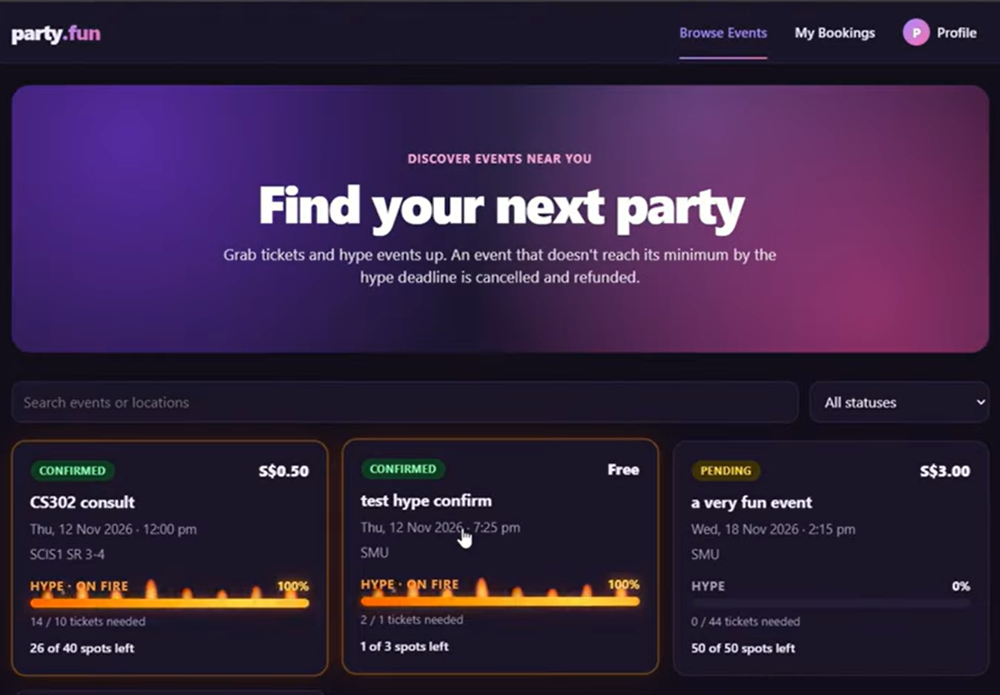
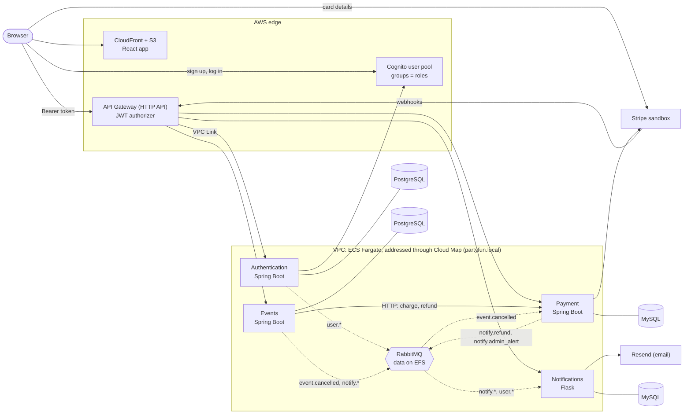

# Party Fun 🎉🥳🎊

## Overview



**party.fun** is an event discovery and ticketing platform for university events. Organisers publish events with a
ticket price, a capacity and a minimum number of signups. Participants buy tickets by card, and every signup pushes
the event's "hype meter" towards that minimum. An event that misses its minimum by its deadline is cancelled
automatically and everyone who paid is refunded.

It is built as four microservices behind an API gateway, with a React frontend, and runs on AWS from CloudFormation
templates. It was a group project for CS302 (DevOps Principles and Practices), so the pipelines, the infrastructure
and the failure handling are as much the point as the features.

| Role | Can do |
|---|---|
| **Participant** | Browse events, buy 1 to 10 tickets, retry a declined payment, view bookings |
| **Organiser** | Everything a participant can, plus create, edit and cancel their own events |
| **Admin** | Review refunds that failed for good and retry them from a dashboard |

Payments run in a Stripe **sandbox**: test cards only, and no real money ever moves.

## Contents

- [Architecture](#architecture)
- [Tech stack](#tech-stack)
- [Repository layout](#repository-layout)
- [How it works](#how-it-works)
- [System design decisions](#system-design-decisions)
- [Running it locally](#running-it-locally)
- [Deploying to AWS](#deploying-to-aws)
- [CI/CD](#cicd)
- [Testing and resilience](#testing-and-resilience)
- [Known limitations](#known-limitations)
- [Further reading](#further-reading)

## Architecture



Solid arrows are HTTP calls; dotted arrows are RabbitMQ messages.

| Component | Owns | Talks to |
|---|---|---|
| **Frontend** ([frontend/](frontend/)) | The 12 user views and the admin dashboard | Cognito directly for login; everything else through API Gateway; Stripe.js for card entry |
| **Authentication** ([services/authentication/](services/authentication/)) | User profiles, and which Cognito group (role) a new user joins | Cognito admin APIs; publishes `user.*` |
| **Events** ([services/events/](services/events/)) | Events, tickets (bookings) and capacity | Calls Payment over HTTP; publishes `event.cancelled` and `notify.*` |
| **Payment** ([services/payment/](services/payment/)) | Every Stripe charge and refund, and the failed-refund queue | Stripe; consumes `event.cancelled`; publishes `notify.refund`, `notify.admin_alert` |
| **Notifications** ([services/notifications/](services/notifications/)) | Emails, the log of what was sent, and a user directory | Consumes `notify.*` and `user.*`; sends through Resend |
| **Infrastructure** ([infrastructure/](infrastructure/)) | Every AWS resource, as CloudFormation | n/a |

## Tech stack

| Layer | Technology |
|---|---|
| Frontend | React 19, TypeScript, Vite, React Router 7, Stripe.js, plain CSS (light and dark themes); nginx when run in Docker |
| Authentication service | Java 17, Spring Boot 4.1, Spring Data JPA, PostgreSQL, AWS SDK for Cognito |
| Events service | Java 21, Spring Boot 4.1, Spring Security (OAuth2 resource server), Spring Data JPA, Spring AMQP, Spring Retry, PostgreSQL |
| Payment service | Java 21, Spring Boot 4.1, Spring Data JPA, Spring AMQP, Stripe Java SDK, MySQL |
| Notifications service | Python 3.14, Flask on waitress, pika, Jinja templates, Resend, SQLite locally or MySQL on AWS |
| Messaging | RabbitMQ (topic exchanges, TTL retry queues, publisher confirms) |
| Identity | Amazon Cognito (user pool, groups as roles, JWT) |
| AWS | CloudFormation, ECS Fargate, Cloud Map, API Gateway HTTP API with a VPC Link, RDS, S3, CloudFront, Secrets Manager, EFS, CloudWatch, Fault Injection Service |
| Observability | OpenTelemetry in every service, an OpenTelemetry Collector, Jaeger, CloudWatch Logs and alarms |
| CI/CD | GitLab CI, Docker (multi-stage builds), hadolint, Checkstyle, SpotBugs, ruff, pylint, Semgrep SAST, secret detection, Trivy, CycloneDX SBOMs, cfn-lint |
| Testing | JUnit 5, Mockito, Testcontainers, WireMock, Toxiproxy, JaCoCo, Vitest, pytest |

## Repository layout

```
frontend/                 React app, its Dockerfile, nginx config and pipeline
services/
  authentication/         profiles and roles around Cognito
  events/                 events, tickets, capacity, the signup and cancel flows
  payment/                Stripe charges, refunds, the failed-refund dead-letter queue
  notifications/          email notifications
  *.md                    a design walkthrough per service (start here to read the code)
infrastructure/
  templates/              one CloudFormation template per stack
  deploy.sh               deploys the shared stacks and the website
  add-user.sh             creates a Cognito user in a role group
  chaos/run.mjs           runs an AWS FIS experiment and checks no money was lost
  DEVOPS_FLOW.md          how a commit becomes a running container
```

Each part was developed as its own GitLab project and consolidated here, so every folder still has its own
README, Dockerfile, Compose file and `.gitlab-ci.yml`.

## How it works

### Login and roles

1. The browser signs up and logs in against **Cognito** directly. No service ever sees a password or issues a token.
2. After sign-up, the frontend calls the Authentication service once (`POST /user/me`). That service creates the
   profile and adds the user to the `participant` or `organiser` Cognito group. A browser cannot choose its own
   group, and nobody can register as an admin.
3. Every later request carries the Cognito access token. **API Gateway** checks its signature, issuer, expiry and
   app client, and rejects a bad token with 401 before any service is called.
4. The service reads the `cognito:groups` claim from the forwarded token and applies its own role rules.

So the gateway answers "is this token genuine?" and each service answers "may this user do this?".

### Buying tickets

1. The card form is Stripe's. Card details go from the browser straight to Stripe, which returns a PaymentMethod id.
   Neither the frontend nor any service handles a card number.
2. The frontend calls `POST /events/{id}/signup` with that id and a quantity.
3. **Events reserves first.** In one short transaction it locks the event row, checks the rules (event open, one
   signup per user, enough places left), takes the places and saves one `PENDING` booking per ticket, each with a
   15-minute payment deadline.
4. **Then it charges**, with no database transaction open: it asks Payment to create a payment-side booking and
   charge it. Payment takes the amount from its own booking record, never from the caller, and creates a Stripe
   PaymentIntent.
5. **Then it records the outcome** with a conditional update (`... WHERE status = 'PENDING'`):
   - paid: every ticket becomes `CONFIRMED` and a `notify.signup` message produces the confirmation email;
   - declined: the tickets stay `PENDING`, the place is held, and the user can retry with another card;
   - no answer from Payment: the tickets stay `PENDING`, and a recovery job that runs every minute asks Payment
     what really happened and confirms them if the card was charged.
6. If the charge succeeded but the tickets are no longer `PENDING` (the event was cancelled meanwhile), Events
   asks Payment for a **compensation refund**, and keeps asking until Payment has taken it over.

### Cancelling an event and refunding

An organiser can cancel an event, and a nightly job cancels events that missed their minimum signups. Both take
the same path:

1. Events cancels the tickets, deletes the event and writes an `event.cancelled` message to its **outbox table**,
   all in one database transaction.
2. A relay publishes the outbox message to RabbitMQ and deletes the row only after the broker confirms delivery.
   If the broker is down, it retries every 10 seconds for as long as it takes.
3. Payment consumes `event.cancelled` and refunds every paid payment of that event through Stripe, one at a time,
   retrying each up to three times.
4. Each successful refund publishes `notify.refund`, and the participant gets an email.
5. A refund that still fails is marked `REFUND_FAILED`, placed in a **dead-letter queue**, and the admin is emailed.
   The admin's dashboard lists these, and **Retry refund** checks what Stripe actually has before refunding again.

The event stays cancelled whatever happens to the refunds. A failed refund goes to a human; it never un-cancels
the event.

### Emails

Services publish `notify.<type>` messages that name the recipient by user id. The Notifications service validates
the payload, looks the address up in its own user directory (built from the Authentication service's `user.*`
messages), renders a template and sends it through Resend. A temporary failure is retried after 30 seconds,
2 minutes and 10 minutes. Every send attempt is written to a notification log.

### Messages on RabbitMQ

| Exchange | Routing key | Published by | Consumed by | Purpose |
|---|---|---|---|---|
| `party.events` | `event.cancelled` | Events (through the outbox) | Payment | Refund everyone who paid for this event |
| `notifications` | `notify.signup`, `notify.event_created`, `notify.event_updated`, `notify.event_deleted` | Events | Notifications | Emails about tickets and events |
| `notifications` | `notify.refund`, `notify.admin_alert` | Payment | Notifications | Refund email; alert for a refund that failed |
| `user.events` | `user.created`, `user.updated`, `user.deleted` | Authentication | Notifications | Keep the user directory current |
| `payments.refund.dlx` | `payments.refunds.dlq` | Payment | Payment, on demand | Failed refunds waiting for the admin |

## System design decisions

| Decision | Why | Trade-off |
|---|---|---|
| **One database per service** (two PostgreSQL, two MySQL), with ids instead of foreign keys across services | Each service can change its schema and be deployed on its own | No joins across services; Events and Payment each keep their own view of a booking |
| **Cognito as the identity provider**, with roles as Cognito groups inside the token | No service stores passwords or signs tokens, and every service reads roles the same way | A role change only takes effect when the token is refreshed |
| **API Gateway validates the token; services authorise** | An invalid request never reaches a container, and role rules stay next to the code they protect | The gateway's built-in authorizer cannot check groups, so each service must |
| **API Gateway with a VPC Link and Cloud Map, no load balancer** | Cloud Map gives each service a stable private name and the gateway finds a healthy task per request, without paying for a load balancer | Service tasks still have public IPs so they can pull their images (see [Known limitations](#known-limitations)) |
| **HTTP for charging, messages for refunds and emails** | A buyer needs the payment result immediately; a refund or an email can wait and must survive an outage | Two communication styles to operate and trace |
| **Reserve, then charge, then confirm; never hold a transaction across a network call** | A row lock on the event prevents overselling, and it is released before the slow Stripe call, so one slow payment never blocks other buyers | The steps can interleave with a cancellation, which is why confirmation is a conditional update and compensation refunds exist |
| **Transactional outbox for `event.cancelled`** | A database and a broker cannot share a transaction; the outbox makes "event cancelled" and "refunds requested" commit together | Delivery is at least once, so the consumer has to be idempotent |
| **Idempotency at every money step**: payment row locks, Stripe idempotency keys, state checks before every transition | A retry, a redelivered message or a lost response can never charge or refund twice | More state to track, such as refund rounds and owed-refund markers |
| **Retry saga, not rollback, for refunds** | A cancelled event should stay cancelled even if Stripe is failing | Needs a dead-letter queue, an admin alert and a recovery screen for the cases retries cannot fix |
| **Scheduled recovery jobs** for lost payment answers, undelivered outbox messages and abandoned refunds | Every flow that can be interrupted has something that finishes it later | Short windows where a booking shows `PENDING` although the card was charged |
| **Sandbox-only payments, enforced in code** | The Payment service refuses to start with a live Stripe key and rejects live webhook events | It cannot take real payments without a deliberate change |
| **Notifications as one contract with two entry points** (RabbitMQ and HTTP) and a `notification_id` on every message | Producers send a user id and a few fields; duplicates are dropped by the log and by Resend's own idempotency key | An email that still fails after three retries is logged and dropped |
| **Build once, promote** | The image that passed the tests and the scan is the exact image that runs on AWS, tagged by commit | Deploys are a separate, manual step |
| **One CloudFormation stack per concern**, wired by stack outputs, with secrets generated in Secrets Manager | Any stack can be deployed alone, and no password is ever typed, committed or kept in a pipeline variable | Some first-time ordering: the API must be redeployed after the services exist |
| **OpenTelemetry Collector between the services and Jaeger** | The tracing backend can be swapped without touching a service, and the Collector strips attributes that look like personal data | One more task to run |
| **Chaos experiments with one hypothesis: a fault costs availability, never money** | The riskiest paths are tested by breaking them on purpose, in CI and on AWS | Experiments take time and need test accounts |

## Running it locally

There is no single Compose file for the whole system. Each part runs from its own folder, and every part's README
has the full detail.

**You need:** Docker Desktop, Node.js 22, JDK 21 (only to run or test the Java services outside Docker), the AWS
CLI v2 with credentials, and Git Bash on Windows for the `.sh` scripts. A Cognito user pool is the one cloud
resource you need even locally, because every service checks tokens against it.

### Smallest working setup: frontend and Events

This gets you login, browsing, and creating, editing and cancelling events, with a stub in place of the Payment
service.

**1. Create the user pool and two test users.**

```bash
cd infrastructure
cp config.env.example config.env
./deploy.sh cognito
./add-user.sh organiser1 organiser@example.com 'YourPassw0rd' organiser
./add-user.sh participant1 participant@example.com 'YourPassw0rd' participant
```

The user pool id and app client id are outputs of the `partyfun-cognito` stack.

**2. Start the Events service** with PostgreSQL, RabbitMQ and a WireMock payment stub. First create
`services/events/.env` as described in [its README](services/events/README.md#run-locally): two local passwords,
`AWS_REGION` and `COGNITO_USER_POOL_ID`.

```bash
cd services/events
EVENTS_PORT=8083 docker compose up -d --build
```

**3. Start the frontend.**

```bash
cd frontend
cp .env.example .env                   # then set VITE_COGNITO_CLIENT_ID
npm install
npm run dev                            # http://localhost:5173
```

Log in with one of the two test users. Free events (price 0) can be signed up for with this setup. Paid checkout
needs the real Payment service, because the card form gets its Stripe publishable key from it.

### Adding the other services

| Service | Start it | It also needs |
|---|---|---|
| [Payment](services/payment/README.md) | `cp dev.env.example dev.env`, then `docker compose up -d --build` in `services/payment` | A local MySQL `payment` database and Stripe sandbox keys. Point Events at it with `EVENTS_PAYMENT_BASE_URL` and a shared `PAYMENT_SERVICE_API_KEY` |
| [Authentication](services/authentication/README.md) | `cp .env.example .env`, then `docker compose up --build` in `services/authentication` | AWS credentials allowed to call the Cognito admin APIs. Needed for the Register page |
| [Notifications](services/notifications/README.md) | `cp .env.example .env`, then `docker compose up --build` in `services/notifications` | Nothing: it logs emails instead of sending them until you set a Resend key |

Two things to sort out when running several at once:

- **Ports.** The frontend expects Payment on 8080, Authentication on 8082 and Events on 8083, but every service's
  Compose file publishes 8080 by default. Remap them, or change `PAYMENT_UPSTREAM`, `AUTH_UPSTREAM` and
  `EVENTS_UPSTREAM` in `frontend/.env`. Notifications uses 5000.
- **One broker.** Each Compose file starts its own RabbitMQ on port 5672. Services only exchange messages if they
  connect to the same broker, so start one and point the others at it.

### Stripe test cards

Any future expiry date and any CVC work.

| Card number | Result |
|---|---|
| `4242 4242 4242 4242` | Payment succeeds |
| `4000 0000 0000 0002` | Declined; the place is held for 15 minutes |
| `4000 0000 0000 9995` | Declined for insufficient funds |
| `4000 0000 0000 5126` | Succeeds; a later refund is reversed by Stripe, which exercises the failed-refund flow |

## Deploying to AWS

Everything is created by the templates in [infrastructure/templates/](infrastructure/templates/). The
[infrastructure README](infrastructure/README.md) is the full guide; this is the outline.

| Stack | Creates |
|---|---|
| `partyfun-secrets` | Secrets Manager secrets: generated passwords and keys, plus placeholders for the Stripe and Resend keys |
| `partyfun-cognito` | The user pool, the web app client and the three role groups |
| `partyfun-frontend` | A private S3 bucket and a CloudFront distribution |
| `partyfun-cluster` | The shared ECS cluster, the `partyfun.local` namespace and the shared security group |
| `partyfun-rabbitmq` | RabbitMQ on Fargate with its data on EFS |
| `partyfun-observability` | The OpenTelemetry Collector and Jaeger |
| `partyfun-api` | The HTTP API, its Cognito JWT authorizer, the VPC Link and the routes |
| `partyfun-events`, `-payment`, `-auth`, `-notifications` | One Fargate service and one RDS database each |
| `partyfun-chaos` | Five Fault Injection Service experiments and the alarm that stops them |

**Shared stacks and the website:**

```bash
cd infrastructure
cp config.env.example config.env
./deploy.sh                            # shows the account and region, then asks before continuing
```

`deploy.sh` deploys the shared stacks in dependency order, builds the frontend against the new API URL and
Cognito client id, uploads it to S3 and refreshes CloudFront. Re-running it changes only what differs.

**Service stacks** are deployed by the manual `deploy-events`, `deploy-payment`, `deploy-auth` and
`deploy-notifications` jobs in [infrastructure/.gitlab-ci.yml](infrastructure/.gitlab-ci.yml). Each job finds the
image its service's pipeline released and passes it to that service's template as `ImageUri`. To deploy without
those jobs, push an image to a registry yourself and run `aws cloudformation deploy` on the template with the
parameters the job's script uses.

**After the first deploy:**

1. Put the Stripe sandbox keys in the `partyfun/payment` secret and the Resend key in `partyfun/notifications`.
2. Redeploy Events (it could not know Payment's address the first time) and then the API (it only creates routes
   for services that exist).
3. Create the admin: `./add-user.sh admin you@example.com 'YourPassw0rd' admin`.

The RabbitMQ and tracing tasks cost roughly US$25 a month each while running. The infrastructure README shows how
to stop them between demos and how to remove everything.

## CI/CD

The pipelines are GitLab CI files, one per folder, written for the original separate GitLab projects. They do not
run from this consolidated repository as it stands.

**Service pipelines build and release an image. They never touch AWS.**

| Stage | What runs |
|---|---|
| Lint and static analysis | hadolint on the Dockerfile; Checkstyle and SpotBugs (Java); ruff and pylint (Python); ESLint and `tsc` (frontend); Semgrep SAST, secret detection and dependency audits |
| Test | Unit tests, then integration tests against real databases and brokers started for the job. The Events pipeline adds chaos tests and a coverage gate of 85% of lines and 75% of branches |
| Package | Build the image once, then smoke-test that exact image: it must start, report healthy, and answer 401 to a request without a token |
| Scan | Trivy vulnerability report and a CycloneDX SBOM. In the Events and Authentication pipelines a fixable critical vulnerability blocks the release |
| Release | Re-tag the tested image and push it. Nothing is rebuilt |

**The infrastructure pipeline deploys. It never builds a backend image.** It runs `cfn-lint` on every push, and on
`main` it offers manual jobs: one per stack, one per service, and the chaos experiments. A service deploy uses an
immutable commit-tagged image, so the task definition records exactly which build is running. ECS then rolls the
service, and its deployment circuit breaker returns to the previous version if the new task never becomes healthy.

[infrastructure/DEVOPS_FLOW.md](infrastructure/DEVOPS_FLOW.md) follows a commit all the way to a running
container, including how the same image gets its configuration on a laptop, in CI and on AWS.

## Testing and resilience

| Part | Run the tests | What they cover |
|---|---|---|
| Frontend | `npm test`, `npm run lint`, `npm run build` | Business rules, the API clients with `fetch` stubbed, role checks, routes, page rendering |
| Events | `./mvnw clean verify` (needs Docker); `./mvnw verify -Pchaos` | Real PostgreSQL and RabbitMQ in Testcontainers, WireMock as Payment; faults injected mid-payment and mid-cancellation |
| Payment | `mvn verify` | Charges, refunds, webhooks, the dead-letter queue, with WireMock as Stripe |
| Authentication | `mvn verify` | Onboarding rules, token checks, access control |
| Notifications | `python -m pytest` | Contract validation, templates, retry and discard decisions; optional runs against real RabbitMQ and MySQL |

**Chaos engineering** happens at two levels, with the same pass condition: every charge ends as a confirmed
booking or as a refund, and nobody is charged twice.

- **In CI:** the Events chaos tests make the payment stub time out, drop connections or return errors, and use
  Toxiproxy to cut the broker connection.
- **On AWS:** five Fault Injection Service experiments stop the Payment task, the broker or the Events task, or
  add packet loss or latency between Events and Payment. [infrastructure/chaos/run.mjs](infrastructure/chaos/run.mjs)
  sends real test traffic during the fault and then checks the money. A CloudWatch alarm, `partyfun-money-at-risk`,
  stops a running experiment the moment a refund reaches the dead-letter queue.

**Observability:** every service exports OpenTelemetry traces to the Collector, which forwards them to Jaeger, so
one signup can be followed across Events, Payment, RabbitMQ and Notifications. Logs go to CloudWatch, one log
group per service, and an alarm fires when an email is dropped.

## Known limitations

These are documented choices and open items for a course project, not surprises.

- **User ids are passed as a parameter.** Events and Payment use integer user ids while Cognito's are UUIDs, so the
  frontend sends a hash of the Cognito id, and the services do not check that it matches the caller's token.
- **Service ports are reachable without the gateway.** Tasks run in public subnets with public IPs so they can
  pull images, and Payment's booking and payment endpoints have no authentication of their own. Private subnets
  with a NAT gateway are the fix.
- **Unpaid bookings are released lazily.** A `PENDING` booking past its 15 minutes only becomes `EXPIRED` when the
  same user signs up for that event again.
- **The minimum-signups check runs once a night**, so an event can be cancelled up to 24 hours after its deadline.
- **3-D Secure cards are not supported.** Such a payment stays `PENDING` until the booking expires.
- **Some messages are best effort.** `user.*` events and the Events service's notification messages are lost if
  the broker is down; only `event.cancelled` goes through the outbox.
- **Operations are sized for a demo.** One task per service, one shared database login across the four RDS
  instances, no secret rotation, traces kept in memory, and SGD as the only currency.

## Further reading

| Topic | Document |
|---|---|
| Frontend: views, roles, payments in the UI, configuration | [frontend/README.md](frontend/README.md) |
| Events: every request flow, the outbox, the scheduled jobs | [services/events.md](services/events.md), [services/events/README.md](services/events/README.md) |
| Events pipeline, job by job | [services/events-pipeline.md](services/events-pipeline.md) |
| Payment: state machines, refunds, idempotency, the dead-letter queue | [services/payment.md](services/payment.md), [services/payment/README.md](services/payment/README.md) |
| Authentication: onboarding, Cognito, access rules | [services/authentication.md](services/authentication.md), [services/authentication/README.md](services/authentication/README.md) |
| Notifications: the message contract, retries, the user directory | [services/notifications.md](services/notifications.md), [services/notifications/README.md](services/notifications/README.md) |
| AWS: stacks, routes, secrets, chaos, cost, teardown | [infrastructure/README.md](infrastructure/README.md) |
| From commit to running container | [infrastructure/DEVOPS_FLOW.md](infrastructure/DEVOPS_FLOW.md) |
