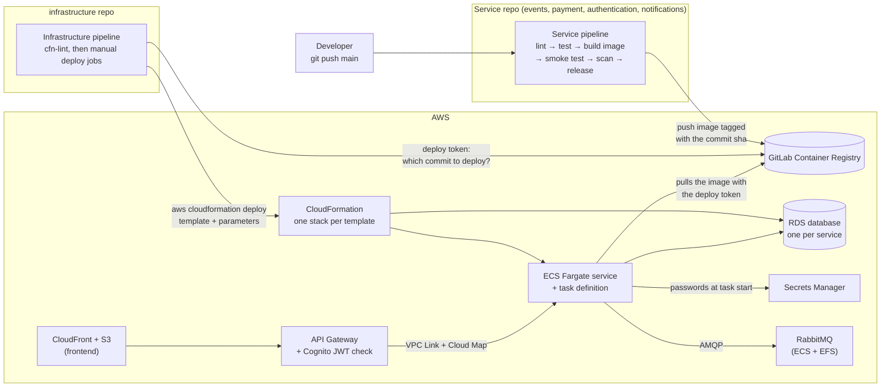

# party.fun DevOps flow: from a push to `main` to running on AWS

This page explains what the `infrastructure` repo does, what each CloudFormation template in this folder creates, and
how a change travels from a developer's commit in a service repo to a running container on AWS. The Event Service is
the worked example for configuration: section 5 shows how the same image gets its database, RabbitMQ and payment
settings on a laptop, in Docker, in CI and on AWS.

Contents

1. [The big picture](#1-the-big-picture)
2. [What is in the infrastructure repo](#2-what-is-in-the-infrastructure-repo)
3. [The service pipelines: from a commit to a released image](#3-the-service-pipelines-from-a-commit-to-a-released-image)
4. [The infrastructure pipeline: from a released image to AWS](#4-the-infrastructure-pipeline-from-a-released-image-to-aws)
5. [Events: how the configuration switches between environments](#5-events-how-the-configuration-switches-between-environments)
6. [Credentials: GitLab tokens, CI/CD variables, Secrets Manager](#6-credentials-gitlab-tokens-cicd-variables-secrets-manager)
7. [How the stacks connect on AWS](#7-how-the-stacks-connect-on-aws)
8. [First deploy, and what to re-run](#8-first-deploy-and-what-to-re-run)
9. [Things worth knowing](#9-things-worth-knowing)

---

## 1. The big picture

There are two kinds of pipeline, and they do different jobs:

- **Each service repo builds and publishes an image.** It never touches AWS.
- **The infrastructure repo deploys.** It never builds a backend image. It finds the image a service released and hands
  its address to CloudFormation.



**A push to a service's `main` never deploys on its own.** Every deploy job is a manual ▶ button in a `main`
pipeline of the infrastructure project.

---

## 2. What is in the infrastructure repo

| File | What it is |
|---|---|
| [`../.gitlab-ci.yml`](../.gitlab-ci.yml) | The infrastructure pipeline: `cfn-lint` on every push, manual deploy jobs and chaos jobs on `main` |
| [`../deploy.sh`](../deploy.sh) | Deploys the shared stacks in a fixed order, then builds and uploads the frontend. Runs the same on a laptop and in CI |
| [`../config.env.example`](../config.env.example) | Non-secret settings for `deploy.sh`: region, stack prefix, optional VPC, admin IPs, frontend folder. Copied to the git-ignored `config.env` |
| [`../add-user.sh`](../add-user.sh) | Creates a Cognito user with a permanent password and puts them in a role group (the way to make an admin) |
| [`../chaos/run.mjs`](../chaos/run.mjs) | Runs one AWS FIS experiment while sending real test traffic, then checks no money was left behind |
| `templates/*.yaml` | One CloudFormation template per stack (below) |

### The templates

Every template takes a `Prefix` parameter (default `partyfun`). The stack is named `<prefix>-<name>` and so are its
resources and exports.

**Shared stacks**, deployed by `deploy.sh`:

| Template | Stack | What it creates |
|---|---|---|
| [secrets.yaml](secrets.yaml) | `partyfun-secrets` | Five Secrets Manager secrets. Passwords and keys are generated by AWS; the Stripe and Resend keys are `CHANGE_ME` placeholders you fill in by hand afterwards |
| [cognito.yaml](cognito.yaml) | `partyfun-cognito` | The user pool, the web app client (no client secret), and the three groups `admin`, `organiser`, `participant` |
| [frontend.yaml](frontend.yaml) | `partyfun-frontend` | A private S3 bucket and a CloudFront distribution that serves it over HTTPS |
| [cluster.yaml](cluster.yaml) | `partyfun-cluster` | The shared ECS cluster `partyfun`, the private DNS namespace `partyfun.local` (Cloud Map), and the shared security group `partyfun-services` |
| [rabbitmq.yaml](rabbitmq.yaml) | `partyfun-rabbitmq` | RabbitMQ as an ECS service with its data on EFS, reachable at `rabbitmq.partyfun.local:5672` |
| [observability.yaml](observability.yaml) | `partyfun-observability` | An OpenTelemetry Collector and Jaeger in one ECS task, at `otel-collector.partyfun.local:4318` |
| [api.yaml](api.yaml) | `partyfun-api` | An API Gateway HTTP API with a Cognito JWT authorizer, a VPC Link, and the routes to each service |

**Service stacks**, deployed by their own jobs in `.gitlab-ci.yml`:

| Template | Stack | Database | Port | Cloud Map name |
|---|---|---|---|---|
| [events.yaml](events.yaml) | `partyfun-events` | RDS PostgreSQL 17, `events_db` | 8080 | `events.partyfun.local` |
| [payment.yaml](payment.yaml) | `partyfun-payment` | RDS MySQL 8.4, `payment` | 8080 | `payment.partyfun.local` |
| [auth.yaml](auth.yaml) | `partyfun-auth` | RDS PostgreSQL 17, `authdb` | 8080 | `auth.partyfun.local` |
| [notifications.yaml](notifications.yaml) | `partyfun-notifications` | RDS MySQL 8.4, `notifications` | 5000 | `notifications.partyfun.local` |

The four service templates have the same shape. Each one creates:

- a registry secret (`partyfun/<service>-registry`) holding the GitLab deploy token ECS pulls the image with;
- two security groups: one for the tasks, one for the database that only accepts the tasks;
- the RDS instance;
- an ECS cluster of its own (`partyfun-<service>`), a log group (`/ecs/partyfun/<service>`), an execution role;
- the task definition (image, environment variables, secret references, health check);
- a Cloud Map registration, and the ECS service that runs the task.

Service-specific extras:

- **auth.yaml** adds a task role allowed to call the Cognito admin APIs, and a generated admin password
  (`partyfun/auth-admin`) when `AdminEmail` is set.
- **notifications.yaml** adds a CloudWatch metric filter, an alarm and an SNS topic that fire when an email is
  dropped after its last retry.
- **events.yaml** can add an SSM agent sidecar (`FaultInjection=true`) so AWS FIS can break its network.

**Chaos:**

| Template | Stack | What it creates |
|---|---|---|
| [chaos.yaml](chaos.yaml) | `partyfun-chaos` | Five AWS FIS experiment templates (payment down, broker down, events crash, payment unreachable, payment slow), the role FIS runs them with, and a "money at risk" alarm that stops any running experiment |

---

## 3. The service pipelines: from a commit to a released image

Each backend repo has its own `.gitlab-ci.yml`. All four need no secret variables: tests start their own throw-away
databases and brokers, and registry access uses GitLab's built-in per-job credentials (`CI_REGISTRY_USER` /
`CI_REGISTRY_PASSWORD`).

| Repo | Stages | Image it publishes | How the deploy job finds it |
|---|---|---|---|
| `services/events` | lint (hadolint) → test (unit, integration with Testcontainers, chaos tests, SAST, secret detection) → package (build, smoke test, push) → scan (Trivy + SBOM) → release | `services/events:<sha>` on every pipeline; `:latest` on `main` | reads the commit label of `:latest` |
| `services/authentication` | lint → static-analysis (SpotBugs) → test → package → scan → release | `services/authentication:<sha>`; `:latest` on `main` | reads the commit label of `:latest` |
| `services/payment` | static_analysis (compile, Checkstyle, SpotBugs, dependency scan, SAST, secret detection) → test (unit, integration with Docker Compose) → release (build, smoke test, push, SBOM, Trivy) | `services/payment/main:<sha>` (no `:latest`) | asks GitLab for the newest commit on `main` |
| `services/notifications` | static_analysis (ruff, pylint, pip-audit, SAST, secret detection) → test (pytest with real RabbitMQ and MySQL) → release (build, push, SBOM, Trivy) | `services/notifications/main:<sha>` (no `:latest`) | asks GitLab for the newest commit on `main` |

### The events pipeline in detail

1. **lint:** `hadolint` checks the Dockerfile.
2. **test**, all in parallel:
   - `unit-tests`: `mvn test`, no Docker.
   - `integration-tests`: `mvn verify` against a real PostgreSQL and RabbitMQ in Testcontainers, with WireMock standing
     in for the Payment Service. Coverage gate: at least 85% of lines and 75% of branches.
   - `chaos-tests`: `mvn verify -Pchaos`. Faults are injected while a payment or a cancellation is in flight. Each
     test asserts that no money is left behind.
   - `semgrep-sast` and `secret_detection` from GitLab's templates.
3. **package: `build-image`.** Runs only if every job above passed.
   - `docker build` with the multi-stage [Dockerfile](../../services/events/Dockerfile): Maven builds a layered jar, and
     a JRE-only Alpine image runs it as a non-root user.
   - The image is labelled `org.opencontainers.image.revision=<commit sha>`. The deploy job reads this label later.
   - `ci/smoke-test.sh` boots the image against real PostgreSQL and RabbitMQ containers and checks that it becomes
     healthy, that `/actuator/health` is `UP`, and that `GET /events` without a token answers 401.
   - Only then is it pushed as `registry.gitlab.com/cs302-2026/g4-team2/services/events:<commit sha>`.
4. **scan: `container-scan`.** Trivy writes a HIGH/CRITICAL report and a CycloneDX SBOM, then **fails on any fixable
   CRITICAL vulnerability**. That blocks the release.
5. **release: `release-image`.** On `main` only, the *same* image is re-tagged `:latest` and pushed. Nothing is
   rebuilt. `:latest` therefore means "the newest build of `main` that passed every test and the scan".

The principle is **build once, promote**: the image that was tested and scanned is byte-for-byte the image that runs
on AWS.

---

## 4. The infrastructure pipeline: from a released image to AWS

### Jobs

`cfn-lint templates/*.yaml` runs on every push. Everything else is manual and only exists on `main`.

| Job | What it runs |
|---|---|
| `deploy-all` | `deploy.sh --yes` (every shared stack and the site), then events, payment, auth, notifications |
| `deploy-secrets` | `deploy.sh --yes secrets` |
| `deploy-cognito-api` | `deploy.sh --yes cognito api` (a Cognito change always needs the API's authorizer updated) |
| `deploy-cluster-rabbitmq` | `deploy.sh --yes cluster rabbitmq` |
| `deploy-observability` | `deploy.sh --yes observability` |
| `deploy-frontend` | `deploy.sh --yes frontend` |
| `deploy-api` | `deploy.sh --yes api` |
| `deploy-site` | clones the frontend repo, then `deploy.sh --yes site` |
| `deploy-events`, `deploy-payment`, `deploy-auth`, `deploy-notifications` | that service's stack with its newest released image |
| `deploy-chaos` | `deploy.sh --yes chaos` |
| `chaos-check`, `chaos-payment-down`, `chaos-broker-down`, `chaos-events-crash`, `chaos-payment-unreachable`, `chaos-payment-slow`, `chaos-all` | `node chaos/run.mjs <experiment>` |

Every deploy job shares the hidden `.deploy` job:

- **`rules`:** only on the default branch, `when: manual`.
- **`resource_group: aws-infrastructure`:** never two deploys at the same time.
- **`before_script`:** installs the AWS CLI and creates `config.env` from `config.env.example`.

The AWS CLI authenticates with the group's protected variables `AWS_ACCESS_KEY_ID` and `AWS_SECRET_ACCESS_KEY`.
Protected variables are only given to pipelines on protected branches, so a feature branch can neither deploy nor
read the keys.

### What `deploy.sh` does

```
secrets → cognito → frontend → cluster → rabbitmq → observability → api → site
```

Parts always run in this order, whichever ones you name. For each stack it runs
`aws cloudformation deploy --stack-name <prefix>-<part> --template-file templates/<part>.yaml`. Re-running changes
only what differs.

Later parts read earlier stacks' outputs:

- **`cluster`** looks up the account's default VPC and its default subnets (unless `VPC_ID` / `SUBNET_IDS` are set).
- **`api`** reads the Cognito issuer and client id, the CloudFront URL, and each service stack's
  `DiscoveryServiceArn`. A service that is not deployed yet simply gets no routes.
- **`site`** reads the API URL, the Cognito client id, the bucket and the distribution. It runs `npm ci` and
  `npm run build` in the frontend folder with the `VITE_*` values set, syncs `dist/` to S3, and invalidates
  CloudFront.

The frontend is the one thing the infrastructure pipeline builds itself. It has to: the API URL and Cognito client
id are baked into the JavaScript bundle at build time, and they only exist after the stacks are deployed.

### What `deploy-events` does, step by step

1. **Log in to the registry** with the deploy token: `skopeo login registry.gitlab.com` using
   `EVENTS_REGISTRY_USERNAME` / `EVENTS_REGISTRY_TOKEN`.
2. **Resolve `:latest` to a commit.** `skopeo inspect services/events:latest` reads the
   `org.opencontainers.image.revision` label, e.g. `a1b2c3…`. The job fails if the label is missing.
3. **Build the image address** `services/events:a1b2c3…`. The job deploys this immutable tag, not `:latest`:
   - the task definition records exactly which build is running;
   - a new build changes the task definition, which makes ECS roll the service;
   - an unchanged build changes nothing.
4. **Look up the network:** the default VPC and its default subnets.
5. **Look up the other stacks.** A helper `stack_output <stack> <key>` runs `aws cloudformation describe-stacks` and
   returns nothing if the stack or output does not exist:

   | Value | Read from | Becomes parameter |
   |---|---|---|
   | shared security group | `partyfun-cluster` → `ServicesSecurityGroupId` | `ServicesSecurityGroupId` |
   | private DNS namespace | `partyfun-cluster` → `NamespaceId` | `NamespaceId` |
   | tracing endpoint | `partyfun-observability` → `OtlpEndpoint` | `OtlpEndpoint` |
   | broker host | CI variable `RABBITMQ_HOST`, else `partyfun-rabbitmq` → `Host` | `RabbitMqHost` |
   | payment URL | CI variable `EVENTS_PAYMENT_BASE_URL`, else `partyfun-payment` → `InternalUrl` | `PaymentBaseUrl` |

6. **Deploy:** `aws cloudformation deploy --stack-name partyfun-events --template-file templates/events.yaml` with
   those parameters, plus the image address and the deploy token (as `NoEcho` parameters).
7. **Wait.** The command returns only when CloudFormation is finished, which includes the new task passing its health
   check. The job then prints the task's public IP and its in-VPC address.

`deploy-auth` works the same way. `deploy-payment` and `deploy-notifications` differ in step 2: those repos publish
no `:latest`, so the job runs `git ls-remote` on the service repo (with `CI_JOB_TOKEN`) to get the newest `main`
commit, then checks that an image with that tag really exists. `PAYMENT_IMAGE_TAG`, `AUTH_IMAGE_TAG` or
`NOTIFICATIONS_IMAGE_TAG` pin a specific commit instead.

### What CloudFormation and ECS then do

- **First deploy** (about 10 to 15 minutes, mostly RDS). Resources are created in dependency order: the registry
  secret, security groups, cluster, log group and role; then the database; then the task definition, which needs the
  database's endpoint; then the service.
- **Later deploys with a new image.** Only `ImageUri` changed, so CloudFormation registers a new task definition
  revision and points the service at it. ECS does a rolling deploy: start a new task, wait for its health check, stop
  the old one (`MinimumHealthyPercent: 100`, `MaximumPercent: 200`).
- **A bad build rolls itself back.** If the new task never becomes healthy, the deployment circuit breaker returns to
  the previous revision, the CloudFormation update fails, and the deploy job fails.

When Fargate starts a task, ECS uses the **execution role** to:

1. read `partyfun/events-registry` and log in to `registry.gitlab.com`;
2. pull `services/events:<sha>` over the internet (the task has a public IP for this);
3. read the secrets the task definition references;
4. start the container with the environment variables from section 5.

ECS then checks `wget http://127.0.0.1:8080/actuator/health/readiness` every 15 seconds, after a 120-second grace
period for JVM startup. Readiness includes the database. Everything the container writes to stdout goes to CloudWatch
Logs, `/ecs/partyfun/events`.

---

## 5. Events: how the configuration switches between environments

**The image never changes. Only the environment variables around it do.** Nothing in the code knows whether it is
running on a laptop or on AWS, and there are no Spring profiles for "local" or "prod".

### The mechanism

[`application.properties`](../../services/events/src/main/resources/application.properties) is built into the jar.
It holds defaults and placeholders, never secrets:

```properties
spring.datasource.url=jdbc:postgresql://localhost:5432/events_db   # a default, can be overridden
spring.datasource.password=${DB_PASSWORD}                          # required, no default
spring.rabbitmq.host=localhost                                     # a default
spring.rabbitmq.username=${RABBITMQ_USERNAME:guest}                # default "guest"
events.payment.base-url=http://localhost:8089                      # a default (the local WireMock stub)
spring.config.import=optional:file:.env[.properties],optional:file:dev.env[.properties]
```

When Spring Boot starts, it looks each setting up in this order. The first match wins:

1. **Operating-system environment variables.** The only source in Docker, CI and ECS.
2. **`.env` / `dev.env`** in the folder the app is started from. This only exists when you run
   `./mvnw spring-boot:run` locally. `optional:` means a missing file is skipped.
3. **The defaults in `application.properties`.**

An environment variable reaches a setting in one of two ways:

- **By placeholder name.** `${DB_PASSWORD}` reads the variable `DB_PASSWORD`.
- **By relaxed binding.** Any property can be overridden by its upper-case form with dots turned into underscores:
  `SPRING_DATASOURCE_URL` → `spring.datasource.url`, `SPRING_RABBITMQ_HOST` → `spring.rabbitmq.host`,
  `EVENTS_PAYMENT_BASE_URL` → `events.payment.base-url`.

So "switching environment" means: whoever starts the container sets different variables.

### Who sets the variables in each environment

| Environment | Who starts the app | Where the values come from |
|---|---|---|
| **Laptop, no Docker** | `./mvnw spring-boot:run` | Spring reads `.env` / `dev.env` itself; everything else falls back to the `localhost` defaults |
| **Laptop, Docker Compose** | `docker compose up` with [`compose.yaml`](../../services/events/compose.yaml) | The `environment:` block of the `events` service. Compose fills its `${...}` from `.env` |
| **CI, tests** | Testcontainers | `IntegrationTestBase` registers the random host and port of each throw-away container with `@DynamicPropertySource` |
| **CI, smoke test** | `ci/smoke-test.sh` | `docker run -e ...` with made-up passwords for throw-away containers |
| **AWS** | ECS | The task definition in [events.yaml](events.yaml): `Environment` for addresses, `Secrets` for passwords |

Two details that are easy to miss:

- **With Compose, the container never sees the `.env` file.** Compose reads `.env` only to fill in the `${...}` in
  `compose.yaml`, then passes the results into the container as ordinary environment variables. `.dockerignore` keeps
  `.env` and `dev.env` out of the image entirely.
- **Docker networking is what makes `postgres` and `rabbitmq` work as host names.** Compose puts every service on one
  network where each service name resolves to its container. On AWS the same job is done by the RDS endpoint and by
  Cloud Map (`rabbitmq.partyfun.local`).

### One setting, every environment

| Setting | Laptop (`mvnw`) | Docker Compose | AWS (events.yaml) |
|---|---|---|---|
| Database address<br/>`spring.datasource.url` | default `localhost:5432/events_db` | `SPRING_DATASOURCE_URL` = `jdbc:postgresql://postgres:5432/events_db` | `SPRING_DATASOURCE_URL` built from the RDS instance's endpoint: `!Sub jdbc:postgresql://${Database.Endpoint.Address}:${Database.Endpoint.Port}/events_db` |
| Database login<br/>`DB_USERNAME`, `DB_PASSWORD` | `.env` / `dev.env` | `.env` → Compose → env var | **Secrets Manager** `partyfun/database`, keys `username` and `password` |
| Broker address<br/>`spring.rabbitmq.host` | default `localhost` | `SPRING_RABBITMQ_HOST` = `rabbitmq` | `SPRING_RABBITMQ_HOST` = `rabbitmq.partyfun.local`, from the rabbitmq stack's `Host` output |
| Broker login<br/>`RABBITMQ_USERNAME`, `RABBITMQ_PASSWORD` | `.env` / `dev.env` | `.env` → Compose → env var | **Secrets Manager** `partyfun/rabbitmq` |
| Payment address<br/>`events.payment.base-url` | default `http://localhost:8089` | `EVENTS_PAYMENT_BASE_URL`, default `http://payment-stub:8080` (WireMock) | `EVENTS_PAYMENT_BASE_URL` = `http://payment.partyfun.local:8080`, from the payment stack's `InternalUrl` output |
| Service key for refunds<br/>`PAYMENT_SERVICE_API_KEY` | `.env`, or empty | `.env`, default `local-service-key` | **Secrets Manager** `partyfun/payment-service-key` |
| Cognito pool<br/>`AWS_REGION`, `COGNITO_USER_POOL_ID` | `.env` / `dev.env` | `.env` → Compose → env var | the stack's region, and `!ImportValue partyfun-user-pool-id` from the cognito stack |
| Schema handling<br/>`spring.jpa.hibernate.ddl-auto` | `create` (default) | `create` (default) | `SPRING_JPA_HIBERNATE_DDL_AUTO` = `update` |
| Tracing<br/>`OTEL_EXPORTER_OTLP_ENDPOINT` | default `localhost:4318` | not set | the observability stack's `OtlpEndpoint`; sampling is `0.0` when there is no collector |

`ddl-auto` matters: the jar's default `create` drops and recreates every table at startup. The task definition
overrides it with `update` so data survives restarts and deploys.

### How a password gets from Secrets Manager into the container

Follow `DB_PASSWORD`:

1. **The secret is generated once.** The first deploy of `partyfun-secrets` asks Secrets Manager to create
   `partyfun/database` as `{"username":"partyfun"}` plus a random 32-character `password`
   (`GenerateSecretString`). Nobody types it, nobody sees it, and it is not in Git.
2. **The database is created with it.** events.yaml sets
   `MasterUserPassword: '{{resolve:secretsmanager:partyfun/database:SecretString:password}}'`. This is a *dynamic
   reference*: CloudFormation fetches the value at deploy time and hands it straight to RDS. It never appears in the
   template, the parameters or the console.
3. **The task definition stores a reference, not the value.**
   `Secrets: - Name: DB_PASSWORD, ValueFrom: <secret ARN>:password::` means "the `password` key of that secret".
4. **ECS injects it at every task start.** Using the execution role, ECS calls `secretsmanager:GetSecretValue`, takes
   the `password` key, and sets it as the environment variable `DB_PASSWORD`.
5. **Spring reads it.** `spring.datasource.password=${DB_PASSWORD}` resolves from that variable, exactly as it would
   from a `.env` file locally.

Because the database and the task both read the same secret, the two can never drift apart.

### How an address gets there

Addresses are not secret, so they travel as plain `Environment` values. They come from three places:

- **A resource in the same stack.** The RDS endpoint is `!GetAtt`-style (`${Database.Endpoint.Address}`). The template
  creates the database and wires its address into the task definition in one deploy.
- **Another stack's export.** `COGNITO_USER_POOL_ID` is `!ImportValue partyfun-user-pool-id`.
- **A parameter the deploy job looked up.** `RabbitMqHost` and `PaymentBaseUrl` come from `stack_output` in the
  pipeline (section 4). The template only sets the variable when the parameter is non-empty:

  ```yaml
  - !If
    - HasRabbitMq
    - Name: SPRING_RABBITMQ_HOST
      Value: !Ref RabbitMqHost
    - !Ref AWS::NoValue
  ```

  If the broker stack does not exist yet, the variable is left out and Spring falls back to `localhost`. The service
  still starts; publishing just fails until the broker exists and `deploy-events` is run again.

### What replaces the `.env` file on AWS

| Kind of setting | Lives in | Reaches the container by |
|---|---|---|
| Passwords and keys | AWS Secrets Manager | the task definition's `Secrets`, injected by ECS at task start |
| Addresses and ids | CloudFormation (resources, exports, parameters) | the task definition's `Environment` |
| Pipeline-only values (AWS keys, deploy token) | GitLab CI/CD variables | never. The one exception is the deploy token, which ECS uses through Secrets Manager to pull the image |

The other services follow the same pattern with their own variable names. Payment uses lower-case names (`db_host`,
`rabbitmq_host`, `stripe_secret_key`); auth and notifications use `DB_HOST` and `RABBITMQ_HOST`.

---

## 6. Credentials: GitLab tokens, CI/CD variables, Secrets Manager

### GitLab tokens

| Token | What it is | Where it is used | Lifetime |
|---|---|---|---|
| `CI_REGISTRY_USER` / `CI_REGISTRY_PASSWORD` | GitLab's automatic per-job registry login | every service pipeline: push the image; Trivy pulls it to scan | ends with the job |
| `CI_JOB_TOKEN` | GitLab's automatic per-job token | infrastructure pipeline: `git clone` the frontend; `git ls-remote` on the payment and notifications repos. Each of those projects' *Job token permissions* must allow the infrastructure project | ends with the job |
| **Deploy tokens** (`read_registry`), one per service | a long-lived, read-only registry login you create on the service project | (1) the deploy job: `skopeo login` and `inspect`; (2) copied by CloudFormation into `partyfun/<service>-registry`, which **ECS uses on every image pull** | until it expires or is revoked |

**Why a deploy token and not the job token?** ECS pulls the image again every time it starts or replaces a task:
after a crash, on AWS maintenance, when scaling, or days after the deploy. The job token is dead by then. A deploy
token is read-only and can be revoked at any time.

### GitLab CI/CD variables

Set on the infrastructure project or the `g4-team2` group (Settings → CI/CD → Variables).

| Variable | Needed? | Used for |
|---|---|---|
| `AWS_ACCESS_KEY_ID`, `AWS_SECRET_ACCESS_KEY`, `AWS_DEFAULT_REGION` | required (group, protected) | every AWS call |
| `EVENTS_REGISTRY_USERNAME` / `_TOKEN`, `PAYMENT_REGISTRY_*`, `AUTH_REGISTRY_*`, `NOTIFICATIONS_REGISTRY_*` | required per service (masked) | the deploy tokens |
| `ECS_EXECUTION_ROLE_ARN`, `ECS_TASK_ROLE_ARN` | optional | use an existing role (e.g. `LabRole`) when the account cannot create IAM roles |
| `RABBITMQ_HOST`, `EVENTS_PAYMENT_BASE_URL` | optional | override the broker host or payment URL the job would read from the stacks |
| `PAYMENT_IMAGE_TAG`, `AUTH_IMAGE_TAG`, `NOTIFICATIONS_IMAGE_TAG` | optional | deploy a specific commit instead of the newest |
| `AUTH_ADMIN_EMAIL`, `AUTH_EMAIL_VERIFICATION` | optional | seed the admin account; require the emailed sign-up code |
| `NOTIFICATIONS_ADMIN_EMAIL`, `_ALARM_EMAIL`, `_EMAIL_FROM`, `_EMAIL_REDIRECT_TO` | optional | notification settings |
| `SKIP_SERVICE_DISCOVERY` | optional | deploy a service once without its Cloud Map registration |
| `EVENTS_FAULT_INJECTION` | optional | add the FIS sidecar to the events task |
| `CHAOS_ORGANISER_*`, `CHAOS_PARTICIPANT_*`, `CHAOS_EXPERIMENTS` | chaos jobs only | test accounts; let a pipeline schedule run `chaos-all` |

### AWS Secrets Manager

| Secret | Created by | Contents | Read by |
|---|---|---|---|
| `partyfun/database` | secrets.yaml (generated) | `username` = `partyfun`, random `password` | CloudFormation (the RDS master login of **all four** databases) and all four services' tasks |
| `partyfun/rabbitmq` | secrets.yaml (generated) | `username` = `partyfun`, random `password` | the broker (its first user) and all four services |
| `partyfun/payment` | secrets.yaml | three Stripe keys (`CHANGE_ME`, set by hand), generated `payment_admin_api_key` | payment |
| `partyfun/payment-service-key` | secrets.yaml (generated) | `payment_service_api_key` | payment (accepts it) and events (sends it on refunds) |
| `partyfun/notifications` | secrets.yaml | `resend_api_key` (`CHANGE_ME`, set by hand), generated `api_key` | notifications |
| `partyfun/<service>-registry` | each service template | that service's deploy token | ECS, to pull the image |
| `partyfun/auth-admin` | auth.yaml | the seeded admin's generated password | auth, when `AdminEmail` is set |

Each service's execution role may read only the secrets its task needs. Application code never calls Secrets Manager.

---

## 7. How the stacks connect on AWS

Stacks share values in two ways:

- **`!ImportValue`** inside a template, for values that must exist: the secret ARNs and the user pool id.
- **Parameters filled by the deploy job** from `describe-stacks`, for values that may not exist yet: the broker host,
  the shared security group, the namespace, the tracing endpoint, the payment URL. An empty parameter switches that
  feature off through a `Condition`, so a service can be deployed before the things it talks to.

### Service to service

Every service task is attached to two security groups: its own, and the shared `partyfun-services` group from the
cluster stack.

| Connection | How the address is known | What allows the traffic |
|---|---|---|
| service → its database | the RDS endpoint, wired in by the same stack | the database's security group accepts only that service's own group |
| service → RabbitMQ | `rabbitmq.partyfun.local` (Cloud Map) | the broker accepts 5672 only from `partyfun-services` |
| events → payment | `http://payment.partyfun.local:8080` (Cloud Map) | the payment tasks' group accepts 8080 |
| service → tracing | `otel-collector.partyfun.local:4318` (Cloud Map) | the collector accepts 4317 and 4318 only from `partyfun-services` |

Cloud Map keeps `<name>.partyfun.local` pointed at the running task's private IP and updates it when a task is
replaced. That is what gives a service a stable address without a load balancer.

### Browser to service

```
Browser → CloudFront (static files from S3)
Browser → API Gateway → JWT authorizer (Cognito) → VPC Link → Cloud Map → the service's task
```

- The JWT authorizer checks the token's signature, issuer, expiry and app client before the backend is called.
  A missing or invalid token gets 401 from API Gateway itself.
- API Gateway asks Cloud Map for a healthy task's IP and port on every request, so a task replaced by a deploy is
  found at once.
- The `Authorization` header is forwarded unchanged. Each service reads `cognito:groups` from the token and applies its
  own role rules.

Routes in [api.yaml](api.yaml):

| Path | Service | Token needed |
|---|---|---|
| `/auth/{proxy+}` | auth | no |
| `/user/{proxy+}` | auth | yes |
| `/events`, `/events/{proxy+}` | events | yes |
| `GET /payments/config`, `GET /payments/{paymentId}`, `POST /payments/webhook/stripe` | payment | no |
| other `/payments…`, `/bookings/{proxy+}`, `/admin/{proxy+}` | payment | yes |
| `GET /notifications`, `GET /notification-types` | notifications | yes |

Each group of routes exists only when that service's `DiscoveryServiceArn` was passed in. The notifications service's
`POST /notify_*` endpoints have no route on purpose: they are for the other services only.

### RabbitMQ

- One task. Its data folder is on EFS, so queued messages survive a task replacement.
- On a deploy the old broker stops before the new one starts (`MinimumHealthyPercent: 0`), so two brokers never write
  the same data. Expect about a minute of downtime; the services reconnect on their own.
- No exchanges or queues are created by the template. Each service declares its own when it connects.

---

## 8. First deploy, and what to re-run

Before the first run:

1. Create the group's AWS variables.
2. Create a `read_registry` deploy token on each service project and store it in that service's `*_REGISTRY_USERNAME` /
   `*_REGISTRY_TOKEN` variables.
3. Allow the infrastructure project in the *Job token permissions* of the frontend, payment and notifications projects.
4. Make sure each service's `main` pipeline has released an image.

Then:

| Step | Job | Why |
|---|---|---|
| 1 | `deploy-all` | every shared stack, the site, then the four services |
| 2 | set the Stripe keys in `partyfun/payment` and the Resend key in `partyfun/notifications` (AWS console) | they are `CHANGE_ME` after the first deploy |
| 3 | `deploy-events` again | on the first run events is deployed before payment, so `payment.partyfun.local` was not known yet |
| 4 | `deploy-api` again | on the first run the API is deployed before the services, so it had no routes to create |
| 5 | `./add-user.sh admin you@example.com '…' admin` (or set `AUTH_ADMIN_EMAIL`) | nobody can sign up as an admin |

Day to day:

| You changed | Run |
|---|---|
| a service's code (after its pipeline released the image) | that service's `deploy-<service>` |
| the frontend's code | `deploy-site` |
| a shared template | the matching `deploy-…` job |
| `cognito.yaml` | `deploy-cognito-api` |
| a service was deployed for the first time, or lost its Cloud Map registration | `deploy-api` |

---

## 9. Things worth knowing

- **Each service has its own ECS cluster.** `partyfun-events`, `partyfun-payment`, `partyfun-auth` and
  `partyfun-notifications` are separate clusters. Only RabbitMQ and the observability task run in the shared `partyfun`
  cluster. What the services share is the security group and the DNS namespace, not the cluster.
- **All four databases use the same login.** `partyfun/database` is one username and password, used as the master
  login of four separate RDS instances. The data is separate (database per service) but one leaked secret opens all
  four. A secret per database would limit that.
- **`partyfun/database` is a secret, not a database.** `events_db` lives on its own RDS instance,
  `partyfun-events-db`.
- **Tasks have public IPs and accept their port from anywhere.** The events, payment and auth security groups open
  8080 to `0.0.0.0/0`, because tasks in public subnets need a public IP to pull images from GitLab. API Gateway is the
  intended entrance but not the only one. The README suggests private subnets with a NAT gateway for production.
- **Secrets are never rotated.** If someone changes `partyfun/database` by hand, RDS keeps the old password until the
  stack is next updated, and the service can no longer log in.
- **Never edit `GenerateSecretString` in secrets.yaml after the first deploy.** CloudFormation would regenerate the
  secret and overwrite the Stripe or Resend keys you set by hand.
- **Payment and notifications deploy "newest commit on `main`", not "newest released image".** If that commit's
  pipeline has not finished (or failed), the deploy job stops with "does not exist". Wait, or set `*_IMAGE_TAG` to an
  older commit.
- **Their image scan does not block a deploy.** In the payment and notifications pipelines the image is pushed before
  Trivy runs, and Trivy has `allow_failure: true`. In the events and authentication pipelines a failed scan stops
  `:latest` from moving.
- **`POST /bookings` has no API Gateway route.** Only `/bookings/{proxy+}` is routed, which does not match the bare
  path. Events calls it inside the VPC, so the signup flow is unaffected.
- **The infrastructure README's "Not done yet" section looks out of date.** It says the Payment Service's admin
  endpoints only accept an HS256 token or the admin key, but the service now also accepts a Cognito token from the
  `admin` group, and payment.yaml passes it `COGNITO_USER_POOL_ID`.
- **Jaeger keeps traces in memory.** They are lost whenever the observability task restarts.
