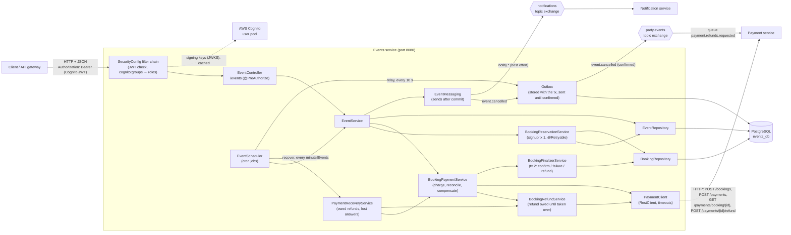
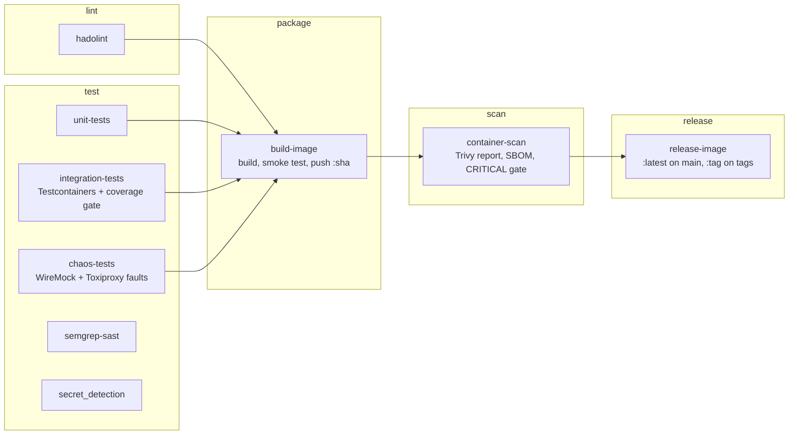
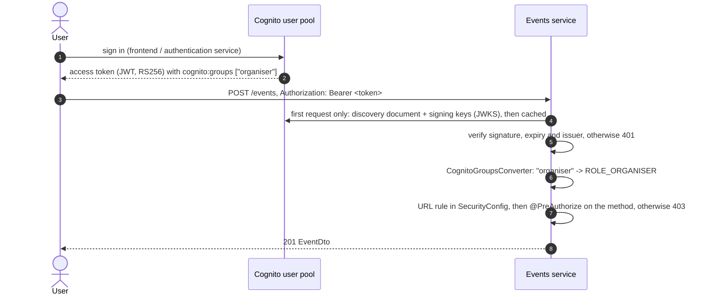
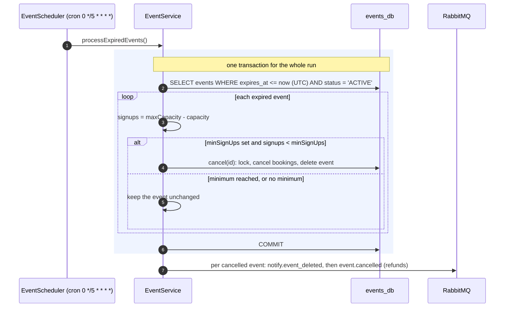
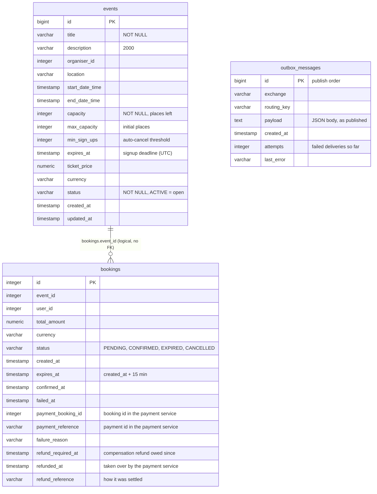

# Events Service

The **Events microservice** of the CS302 group project (G4 Team 2). It owns events and the bookings made for them:

- **Event management**: create, list, get, update, cancel and delete events (title, venue, schedule, capacity, ticket price, minimum signups and their deadline).
- **Signups / bookings**: a user signs up for an event, buying 1 to 10 tickets in one request (`quantity`); the service reserves one place per ticket under a row lock (all or nothing), creates a `PENDING` booking per ticket with a 15-minute payment window, and charges the signup's tickets (one order) **once, for their total**, through the **payment service** (Stripe, test mode). A paid order's bookings all become `CONFIRMED`; a declined card keeps the places for a retry.
- **Auto-cancel**: an event can require a minimum number of signups (`minSignUps`) by a deadline (`expiresAt`). A scheduled job (every 5 minutes) cancels every event that missed its minimum, exactly as an organiser's cancel would, so paid bookings are refunded.
- **Security**: every endpoint except the health probes needs an **AWS Cognito access token** (`Authorization: Bearer ...`). The user's Cognito groups (`participant`, `organiser`, `admin`) decide which endpoints they may call.
- **Domain events**: every change is published to **RabbitMQ** as JSON once its database transaction commits, so the notification and payment services can react without calling this service directly.
- **Saga participant**: signups and event cancellations are steps of a **saga** that spans the events, payment and notification services: a synchronous payment call at signup, and a one-way `event.cancelled` request on cancellation, after which the payment service cancels and refunds on its side (no refund confirmation comes back).
- **No money left behind**: if the payment service or RabbitMQ fails half-way, nothing that involves money is dropped. `event.cancelled` waits in a transactional **outbox** until the broker confirms it, a compensation refund stays **owed** until the payment service takes it over, and a charge whose answer was lost is found and confirmed by the **payment recovery** job. The **chaos tests** prove each of these by breaking the payment service and the broker mid-saga (see [Chaos engineering](#6-chaos-engineering)).

> [!NOTE]
> The scheduled job expires **events**, not bookings: a lapsed `PENDING` booking still only gives its place back when the same user signs up again. See [Known issues](#known-issues).

---

## Contents

1. [Tech stack and dependencies](#tech-stack-and-dependencies)
2. [Architecture](#architecture)
3. [Project structure](#project-structure)
4. [Configuration and secrets](#configuration-and-secrets)
5. [Run locally](#run-locally)
6. [Deploy to the cloud](#deploy-to-the-cloud)
7. [API](#api)
8. [Flows](#flows)
9. [RabbitMQ messaging](#rabbitmq-messaging)
10. [Database schema](#database-schema)
11. [Concurrency and resilience](#concurrency-and-resilience)
12. [Known issues](#known-issues)

---

## Tech stack and dependencies

| Concern | Technology |
| --- | --- |
| Language / runtime | Java 21 |
| Framework | Spring Boot 4.1.1 (Spring MVC, embedded Tomcat, port 8080) |
| Persistence | Spring Data JPA + Hibernate, PostgreSQL (developed on 17) |
| Messaging | RabbitMQ via Spring AMQP (`RabbitTemplate` publisher only, JSON messages); `event.cancelled` through a transactional outbox with publisher confirms and returns |
| Security | Spring Security OAuth2 resource server: Cognito JWTs (signature, expiry, issuer), `cognito:groups` → roles, URL rules + `@PreAuthorize` |
| Scheduling | Spring `@Scheduled` cron jobs (`EventScheduler`): auto-cancel of under-subscribed events, the outbox relay, payment recovery |
| Service calls | Spring `RestClient` → payment service (`POST /bookings`, `POST /payments`, refunds with `X-Service-Api-Key`), with connect/read timeouts |
| Resilience | Spring Retry 2.0.12 (`@Retryable` on lock failures), pessimistic row locks, outbox, owed refunds retried until taken over, reconciliation of lost payment answers |
| Health | Spring Boot Actuator: `/actuator/health`, `/health/liveness`, `/health/readiness` |
| Build | Maven 3.10.0, via the included wrapper (`mvnw` / `mvnw.cmd`) |
| Container | Multi-stage Dockerfile (layered jar, non-root, `HEALTHCHECK`), Docker Compose for the local stack |
| Testing | JUnit 5, Mockito, Testcontainers (PostgreSQL, RabbitMQ, Toxiproxy), WireMock 3.13.2 as the payment service |
| CI/CD | GitLab CI: hadolint, unit + Testcontainers integration tests, coverage gate, chaos tests, SAST, secret detection, image smoke test, Trivy scan + SBOM, promotion to `latest` / tag |

Maven dependencies ([pom.xml](pom.xml)):

| Dependency | Why |
| --- | --- |
| `spring-boot-starter-webmvc` | REST API, JSON (Jackson), embedded Tomcat |
| `spring-boot-starter-validation` | Bean Validation (`@Valid` on request bodies) |
| `spring-boot-starter-data-jpa` | Entities, repositories, `@Transactional` |
| `spring-boot-starter-jdbc` | `JdbcTemplate` / DataSource |
| `spring-boot-starter-security` | Authentication and authorisation (filter chain, `@PreAuthorize`) |
| `spring-boot-starter-oauth2-resource-server` | Validates Cognito JWT access tokens (keys downloaded from the user pool's JWKS) |
| `spring-boot-starter-amqp` | RabbitMQ publishing |
| `spring-boot-starter-actuator` | Health probes (only `health` is exposed) |
| `spring-retry` + `spring-aspects` | `@Retryable` (version pinned: Boot 4 no longer manages it) |
| `postgresql` (runtime) | JDBC driver |
| `spring-boot-devtools` (runtime, optional) | Auto-restart during local development; not packaged |
| `lombok` (optional) | Declared but unused |
| `spring-boot-starter-webmvc-test` (test) | JUnit, Mockito, AssertJ, Spring Boot test, MockMvc |
| `testcontainers-*` (test) | Throw-away PostgreSQL and RabbitMQ for the integration tests, and Toxiproxy in front of RabbitMQ so the chaos tests can cut it |
| `wiremock-standalone` (test) | The payment service in unit, integration and chaos tests (version pinned: not managed by Boot; the standalone jar shades its own Jetty and Jackson) |
| `awaitility` (test) | Waiting for asynchronous effects in integration and chaos tests (a payment in flight) |

Build plugins: Failsafe (integration tests; the `chaos` profile runs only the chaos tests) and JaCoCo 0.8.13 (coverage report and gate). The `<properties>` block also
overrides three versions managed by Spring Boot 4.1.1 (Tomcat, Jackson, the RabbitMQ client) to patched releases
flagged by the CI container scan; remove each override once a Spring Boot release manages that version or newer.

There is no `requirements.txt`: that is a Python convention. In this Maven project `pom.xml` is the dependency list.

---

## Architecture



| Layer | Package | Responsibility |
| --- | --- | --- |
| Security | `events.config` | `SecurityConfig` (JWT resource server, URL role rules, `@EnableMethodSecurity`) and `CognitoGroupsConverter` (`cognito:groups` → `ROLE_*`). |
| Web | `events.controller` | REST endpoints with per-method `@PreAuthorize` role checks (`EventController`), error mapping (`EventExceptionHandler`) and the scheduled jobs (`EventScheduler`). No business logic. |
| Service | `events.service` | Business rules, transactions, retries, the payment saga and its compensation refunds, payment recovery, auto-cancel of expired events, and when to publish. |
| Integration | `events.client` | `PaymentClient`: HTTP calls to the payment service, translated into `PaymentRejectedException` (4xx) / `PaymentUnavailableException` (no definite answer). |
| Persistence | `events.repository`, `events.entity` | JPA entities and repositories, incl. the `SELECT ... FOR UPDATE` lookup and the expired-events query. |
| Messaging | `events.messaging`, `events.config` | Exchange declarations, JSON converter, publishing after commit, and the transactional outbox for `event.cancelled`. Nothing is consumed. |
| Contracts | `events.dto`, `events.exception` | API and message payloads, one exception class per business error. |

---

## Project structure

```
events/
├── pom.xml                       # Maven build and dependencies
├── mvnw, mvnw.cmd, .mvn/wrapper/ # Maven wrapper (no local Maven install needed)
├── Dockerfile                    # multi-stage: Maven builds a layered jar, JRE 21 Alpine runs it as non-root, HEALTHCHECK
├── compose.yaml                  # local stack: postgres, rabbitmq, events, payment-stub (WireMock)
├── .gitlab-ci.yml                # CI/CD pipeline (see "GitLab CI/CD")
├── ci/smoke-test.sh              # boots an image against real PostgreSQL + RabbitMQ and checks its health (used by CI)
├── .gitignore                    # keeps secrets, build output, IDE and OS files out of git
├── .gitattributes                # LF line endings for shell scripts and mvnw (they run on Linux)
├── .dockerignore                 # allowlist: only pom.xml and src/main/ reach the image build
└── src/
    ├── main/java/events/
    │   ├── EventsApplication.java                # entry point, @EnableRetry, @EnableScheduling
    │   ├── config/SecurityConfig.java            # JWT resource server, URL role rules, @EnableMethodSecurity
    │   ├── config/CognitoGroupsConverter.java    # cognito:groups claim -> ROLE_PARTICIPANT / ROLE_ORGANISER / ROLE_ADMIN
    │   ├── config/RabbitMQConfig.java            # topic exchanges, JSON converter
    │   ├── controller/EventController.java       # REST API under /events, @PreAuthorize on every method
    │   ├── controller/EventExceptionHandler.java # exceptions -> 400/404/409/503 ProblemDetail
    │   ├── controller/EventScheduler.java        # cron jobs: auto-cancel, outbox relay, payment recovery
    │   ├── client/PaymentClient.java             # HTTP client for the payment service (+ response records, 2 exceptions)
    │   ├── service/EventService.java             # CRUD, cancel, expiry check, signup + payment retry orchestration
    │   ├── service/BookingReservationService.java# signup tx 1: lock event, take a place, PENDING booking
    │   ├── service/BookingPaymentService.java    # signup step 2: charge, reconcile lost answers, refund if too late
    │   ├── service/BookingRefundService.java     # compensation refunds: owed until the payment service takes them over
    │   ├── service/PaymentRecoveryService.java   # every minute: retry owed refunds, confirm charges whose answer was lost
    │   ├── service/BookingFinalizerService.java  # tx 2: confirm / record decline / refund owed and settled
    │   ├── repository/                           # EventRepository (row lock, expired events), BookingRepository, OutboxMessageRepository
    │   ├── entity/                               # Event, Booking, BookingStatus, OutboxMessage
    │   ├── dto/                                  # EventDto, message bodies (notification, event.cancelled)
    │   ├── messaging/EventMessaging.java         # RabbitMQ publisher
    │   ├── messaging/Outbox.java                 # transactional outbox for event.cancelled (publisher confirms)
    │   └── exception/                            # EventException (base) + one class per error
    ├── main/resources/application.properties     # configuration (no secrets)
    ├── test/java/events/
    │   ├── client/, config/, controller/, messaging/, service/  # unit tests (*Test): Mockito, WireMock, @WebMvcTest
    │   └── integration/                                         # integration tests (*IT) and chaos tests (*ChaosIT)
    └── test/resources/wiremock/payment/mappings/  # the payment service's stubs (tests and compose.yaml's payment-stub)
```

Business exceptions ([exception/](src/main/java/events/exception/)), all extending the abstract `EventException`:

| Exception | When | HTTP |
| --- | --- | --- |
| `EventNotFoundException` | Event id does not exist | 404 |
| `BookingNotFoundException` | Booking id does not exist, or belongs to another event | 404 |
| `EventNotOpenException` | Signup on an event that is not `ACTIVE` | 409 |
| `EventFullException` | Signup with no places left | 409 |
| `DuplicateBookingException` | User already has a `PENDING` or `CONFIRMED` booking for the event | 409 |
| `BookingNotPayableException` | Payment retry for a booking that is not `PENDING` or whose payment window closed | 409 |
| `InvalidRequestException` | Missing title, user id or `paymentMethodId`; end not after start; capacity too low; price not payable; currency not SGD | 400 |

Payment-service errors live in `events.client` (they are not business errors): `PaymentUnavailableException` (no definite answer) becomes **503** on a payment retry; during signup it is caught and the booking stays `PENDING`. `PaymentRejectedException` (4xx) never reaches the client: it is recorded as the booking's `failureReason`.

---

## Configuration and secrets

All configuration lives in [application.properties](src/main/resources/application.properties). **It contains no secrets**: passwords are placeholders resolved at startup from, in order of precedence:

1. **Environment variables** (Docker, GitLab, cloud).
2. A local, git-ignored **`.env`** or **`dev.env`** file in the project root (loaded by `spring.config.import`; optional, so it is simply skipped when absent).

| Variable | Required | Default | Used for |
| --- | --- | --- | --- |
| `DB_PASSWORD` | **yes** | none | `spring.datasource.password` |
| `DB_USERNAME` | no | `postgres` | `spring.datasource.username` |
| `RABBITMQ_PASSWORD` | **yes** | none | `spring.rabbitmq.password` |
| `RABBITMQ_USERNAME` | no | `guest` | `spring.rabbitmq.username` |
| `AWS_REGION` | **yes**, for authenticated requests | `ap-southeast-1` | Cognito issuer `https://cognito-idp.${AWS_REGION}.amazonaws.com/${COGNITO_USER_POOL_ID}` |
| `COGNITO_USER_POOL_ID` | **yes**, for authenticated requests | empty (every token is rejected) | Same issuer URI (e.g. `ap-southeast-1_AbCdEfGhI`) |
| `PAYMENT_SERVICE_API_KEY` (or `payment_service_api_key`) | **yes**, for refunds | empty (every refund is refused with 401 and stays owed) | `X-Service-Api-Key` on `POST /payments/{id}/refund`: the same secret as the payment service's `payment_service_api_key` |

If a required password is missing, startup fails with `Could not resolve placeholder 'DB_PASSWORD'`. Nothing silently falls back to a hard-coded password.

The Cognito settings are not secrets, but they are needed: the service still **starts** without them (the token decoder is created lazily, so the health probes work), but every request carrying a token then fails because the issuer cannot be resolved. With them set, the service downloads the user pool's discovery document and signing keys (JWKS) on the first authenticated request, so it needs outbound HTTPS access to `cognito-idp.<region>.amazonaws.com`.

Any other property can be overridden with Spring Boot's relaxed env-var binding (upper-case, `.` and `-` become `_`):

| Property | Default | Env var |
| --- | --- | --- |
| `server.port` | `8080` | `SERVER_PORT` |
| `spring.datasource.url` | `jdbc:postgresql://localhost:5432/events_db` | `SPRING_DATASOURCE_URL` |
| `spring.rabbitmq.host` / `port` | `localhost` / `5672` | `SPRING_RABBITMQ_HOST` / `SPRING_RABBITMQ_PORT` |
| `events.rabbitmq.notifications-exchange` | `notifications` | `EVENTS_RABBITMQ_NOTIFICATIONS_EXCHANGE` |
| `events.rabbitmq.party-events-exchange` | `party.events` | `EVENTS_RABBITMQ_PARTY_EVENTS_EXCHANGE` |
| `app.scheduling.event-check-cron` | `0 */5 * * * *` (every 5 minutes) | `APP_SCHEDULING_EVENT_CHECK_CRON` (Spring 6-field cron; `-` disables the job) |
| `events.payment.base-url` | `http://localhost:8089` (Compose's `payment-stub`) | `EVENTS_PAYMENT_BASE_URL` (e.g. `http://payment:8080` in Docker) |
| `events.payment.connect-timeout` / `read-timeout` | `2s` / `10s` | `EVENTS_PAYMENT_CONNECT_TIMEOUT` / `EVENTS_PAYMENT_READ_TIMEOUT` |
| `events.payment.recovery-cron` | `30 * * * * *` (every minute) | `EVENTS_PAYMENT_RECOVERY_CRON`: retries owed refunds, confirms charges whose answer was lost (`-` disables it) |
| `events.payment.reconcile-after` | `1m` | `EVENTS_PAYMENT_RECONCILE_AFTER`: how old a `PENDING` booking must be before recovery asks the payment service about it |
| `events.outbox.relay-cron` | `*/10 * * * * *` (every 10 s) | `EVENTS_OUTBOX_RELAY_CRON`: re-sends `event.cancelled` messages the broker has not confirmed (`-` disables it) |
| `events.outbox.confirm-timeout` | `5s` | `EVENTS_OUTBOX_CONFIRM_TIMEOUT`: how long the outbox waits for the broker's publisher confirm |
| `spring.jpa.hibernate.ddl-auto` | `update` | `SPRING_JPA_HIBERNATE_DDL_AUTO` |
| `spring.jpa.show-sql` | `true` | `SPRING_JPA_SHOW_SQL` (set `false` in the cloud) |

Health endpoints (Actuator; only `health` is exposed, without details, and **no token is needed**):
`/actuator/health` (overall, includes PostgreSQL and RabbitMQ), `/actuator/health/liveness` (the JVM answers; used by
the Docker `HEALTHCHECK`) and `/actuator/health/readiness` (includes the database: not ready while PostgreSQL is down).

`application.properties` still contains `events.rabbitmq.payments-refunded-queue` and the
`spring.rabbitmq.listener.simple.*` retry settings from the removed `payments.refunded` consumer. Nothing reads them
any more.

Hard-coded in Java: 15-minute payment window (`BookingReservationService.BOOKING_TIMEOUT_MINUTES`), 5 s row-lock timeout (`EventRepository`), signup retry policy of 3 attempts at 50 ms → 100 ms (`@Retryable` on `reserve`), and the role rules per endpoint (`SecurityConfig` and `@PreAuthorize` in `EventController`; see [Authentication and roles](#authentication-and-roles)).

> [!CAUTION]
> Never commit `.env`, `dev.env`, keys or certificates. `.gitignore` and `.dockerignore` already exclude them. Run `git status` before committing, and if a real secret is ever committed, **rotate it**: removing it in a later commit leaves it in the history.

---

## Run locally

Prerequisites: **Docker Desktop**, and **JDK 21** for running with Maven or running the tests (Maven itself is
downloaded by the wrapper). Locally the payment service is **WireMock** (`payment-stub`), serving the same stubs as the
tests, so no Stripe key or MySQL is needed. To test against the real payment service, run it from its own repository
and point `EVENTS_PAYMENT_BASE_URL` and `PAYMENT_SERVICE_API_KEY` at it.

### 1. Create your local secrets file

Create a file named `.env` in the project root, next to `pom.xml`. Both the service (`spring.config.import`) and
Docker Compose (variable interpolation) read it:

```properties
# Local development only. This file is git-ignored and docker-ignored: never commit it.
# Comments go on their own lines: Spring reads this file as Java properties, where "value  # note" is all value.
DB_USERNAME=postgres
DB_PASSWORD=<choose a local postgres password>
RABBITMQ_USERNAME=guest
RABBITMQ_PASSWORD=<choose a local RabbitMQ password>
AWS_REGION=<region of the team's Cognito user pool, e.g. ap-southeast-1>
COGNITO_USER_POOL_ID=<user pool id, e.g. ap-southeast-1_AbCdEfGhI>
# Any value for payment-stub; the same value as the payment service's PAYMENT_SERVICE_API_KEY otherwise
PAYMENT_SERVICE_API_KEY=<openssl rand -hex 32>
```

Only variables that `application.properties` or `compose.yaml` refer to by name work here (the ones above). A
relaxed name such as `EVENTS_PAYMENT_BASE_URL` is **not** picked up from this file by the service; set it in the shell
instead. The database and RabbitMQ passwords are set when their Docker volumes are first created: after changing them,
run `docker compose down -v` (this deletes the local data).

### 2a. Run everything in Docker (recommended)

[compose.yaml](compose.yaml) builds this service from the Dockerfile and starts it with PostgreSQL, RabbitMQ and
`payment-stub` (WireMock with the stubs in [src/test/resources/wiremock/payment](src/test/resources/wiremock/payment/mappings)).
Containers start in dependency order and only once their dependencies are healthy.

```bash
docker compose up -d --build    # events + postgres + rabbitmq + payment-stub
docker compose ps               # wait until events shows "healthy" (about 30 s)
docker compose logs -f events   # follow the logs
docker compose down             # stop; add -v to also delete the database volumes
```

| Port | Service |
| --- | --- |
| `8080` | Events service (set `EVENTS_PORT=18080` if 8080 is taken, e.g. by `mvnw spring-boot:run`) |
| `8089` | `payment-stub` (WireMock); <http://localhost:8089/__admin/requests> lists every call the service made to it |
| `5672`, `15672` | RabbitMQ, management UI <http://localhost:15672>. If another broker already uses them, set `RABBITMQ_PORT` / `RABBITMQ_UI_PORT` in `.env` (the service run with Maven reads `RABBITMQ_PORT` too) |

PostgreSQL is not published, so it never clashes with a database already running on your machine. Inspect
the events database with `docker compose exec postgres psql -U postgres -d events_db`.

> [!WARNING]
> Without a real `COGNITO_USER_POOL_ID` in `.env` the stack still starts and the health probes work, but every request
> with a token is rejected (`401`). Get the pool id from whoever runs the team's AWS account (Cognito → User pools).

> [!NOTE]
> Every running instance has its own expiry job. Two instances against the same database (e.g. Compose plus
> `mvnw spring-boot:run`) both check expired events every 5 minutes and can race to cancel the same event; see
> [Known issues](#known-issues).

### 2b. Run the service with Maven (development, debugging)

Start the dependencies in Docker, then the service on your machine. Its defaults expect PostgreSQL on
`localhost:5432`, RabbitMQ on `localhost:5672` and the payment service on `localhost:8089` (`payment-stub`):

```bash
docker run -d --name events-postgres -e POSTGRES_PASSWORD=<DB_PASSWORD from .env> -e POSTGRES_DB=events_db -p 5432:5432 postgres:17
docker compose up -d rabbitmq payment-stub
./mvnw spring-boot:run          # Linux / macOS, from the project root so .env is found
.\mvnw.cmd spring-boot:run      # Windows PowerShell
```

Hibernate creates the events tables on first start (`ddl-auto=update`). If you get odd compile results, use
`./mvnw clean compile`: a plain `compile` can reuse stale classes from `target/`.

### 3. Check it is up

```bash
curl http://localhost:8080/actuator/health    # {"groups":["liveness","readiness"],"status":"UP"}
curl http://localhost:8089/__admin/health     # payment-stub: {"status":"healthy",...}
```

### 4. Try it

Every `/events` call needs a Cognito **access token** of a user in the right group (see
[Authentication and roles](#authentication-and-roles)). Get one by signing in through the authentication service or
the frontend, or with the AWS CLI if the user pool's app client allows `USER_PASSWORD_AUTH`:

```bash
ORGANISER=$(aws cognito-idp initiate-auth --auth-flow USER_PASSWORD_AUTH --client-id <app client id> \
  --auth-parameters USERNAME=<organiser user>,PASSWORD=<password> --query AuthenticationResult.AccessToken --output text)
PARTICIPANT=<same command for a user in the participant group>
```

```bash
curl -i http://localhost:8080/events                                                                   # 401: no token
curl http://localhost:8080/events -H "Authorization: Bearer $PARTICIPANT"
curl -X POST http://localhost:8080/events -H "Authorization: Bearer $ORGANISER" -H "Content-Type: application/json" \
  -d '{"title":"Demo","capacity":10,"ticketPrice":15.00,"currency":"SGD","minSignUps":3,"expiresAt":"2026-11-15T12:00:00"}'
curl -i -X POST http://localhost:8080/events -H "Authorization: Bearer $PARTICIPANT" -H "Content-Type: application/json" -d '{"title":"X","capacity":1}'  # 403
curl -X POST "http://localhost:8080/events/1/signup?userId=42&paymentMethodId=pm_card_visa" -H "Authorization: Bearer $PARTICIPANT"            # CONFIRMED
curl -X POST "http://localhost:8080/events/1/signup?userId=43&paymentMethodId=pm_card_chargeDeclined" -H "Authorization: Bearer $PARTICIPANT"  # PENDING + failureReason
curl -X POST "http://localhost:8080/events/1/bookings/2/payment?paymentMethodId=pm_card_visa" -H "Authorization: Bearer $PARTICIPANT"          # retry -> CONFIRMED
curl -X POST http://localhost:8080/events/1/cancel -H "Authorization: Bearer $ORGANISER"                                                       # event.cancelled -> refunds
```

### 5. Tests

The full test run (unit + integration tests, then the coverage report and gate) needs **Docker running**, because the
integration tests start their own PostgreSQL, RabbitMQ and Toxiproxy containers (WireMock runs inside the test JVM):

1. Start **Docker Desktop** and wait until it reports that the engine is running (`docker version` should print a
   `Server:` section, not a connection error).
2. From the project root, run:

   ```bash
   ./mvnw clean verify       # Linux / macOS / Git Bash
   .\mvnw.cmd clean verify   # Windows PowerShell
   ```

   This runs the unit tests (Surefire), then the integration tests (Failsafe), then writes the JaCoCo report and fails
   the build if line coverage is below **85%** or branch coverage below **75%**. Use `clean verify`, not just `verify`:
   the coverage data file is appended to between runs, so without `clean` the numbers mix in old runs.
3. Open the coverage report in a browser:

   ```bash
   start target\site\jacoco\index.html   # Windows (PowerShell or cmd)
   open target/site/jacoco/index.html    # macOS
   xdg-open target/site/jacoco/index.html  # Linux
   ```

   (or double-click `target/site/jacoco/index.html` in your file explorer). The first page lists coverage per package;
   click a package, then a class, then a method or the source file name to see the **source line by line**:

   | Marking | Meaning |
   | --- | --- |
   | Green line | Executed by at least one test |
   | Yellow line | Executed, but only some of its branches (e.g. one side of an `if`) |
   | Red line | Never executed |
   | Diamond in the left margin | A line with branches: green = all branches taken, yellow = some, red = none. Hover over it for e.g. "1 of 2 branches missed." |

   The tables show, per package, class and method, the **Instructions**, **Branches**, **Lines** and **Methods** columns
   (missed vs total, with a percentage); the gate checks the bundle's **Lines** and **Branches** totals.

Other commands:

```bash
./mvnw test                      # unit tests only: ~20 s, no Docker, database or network needed
./mvnw clean verify -DskipITs    # unit tests + coverage report and gate, without Docker (report covers unit tests only)
./mvnw verify -Pchaos            # chaos tests only (needs Docker, ~2 min): see Chaos engineering below
```

No command needs your `.env`, a running PostgreSQL / RabbitMQ, the payment service or a Cognito user pool: everything
the tests use is mocked or started by the tests themselves. If `clean` fails with "Failed to delete ... target", an IDE
(e.g. the VS Code Java extension) is holding files in `target/`: close it or wait a moment and retry.

| Kind | Classes | Runs in | What it covers |
| --- | --- | --- | --- |
| Unit | `*Test` in `client/`, `config/`, `controller/`, `messaging/`, `service/` | `test` phase (Surefire) | Every service rule and payment outcome with Mockito, including the auto-cancel rule (below the minimum → cancelled, at or above it or without one → kept) and `maxCapacity` defaulting; every compensation-refund and recovery outcome; the outbox (deleted only after a confirmed, routed publish); the HTTP client's wire format, service key, timeouts and dropped connections against **WireMock** over real HTTP; routes, status codes and problem bodies with `@WebMvcTest`, plus the **role matrix**: every endpoint without a token → `401`, organisers and admins allowed everywhere, participants allowed to browse, sign up and pay but `403` on create/update/cancel/delete, unknown or missing groups → `403`, a rejected token → `401`; `cognito:groups` → role mapping (case- and locale-independent); message contracts and publish-after-commit |
| Integration | `*IT` in `integration/` | `integration-test` phase (Failsafe) | The whole app on a random port against **real PostgreSQL 17 and RabbitMQ 4.3 in Testcontainers** and **WireMock** for the payment service (default stubs in `src/test/resources/wiremock/payment`, test-specific ones in `PaymentStubs`). Includes 10 concurrent signups on 3 places (no overselling under the real row lock), a lost payment answer reconciled without a second charge, a payment-service outage, compensation when the event is cancelled mid-payment (refunded with the service key), a payment found by recovery while its own request was still waiting (not refunded), `event.cancelled` on the real broker through the outbox, health probes without a token, forged and expired tokens rejected, participant limits on the running app (`SecurityIT`), and auto-cancel of an expired under-subscribed event against the real database and broker (`EventExpiryIT`) |
| Chaos | `*ChaosIT` in `integration/` (JUnit tag `chaos`) | Failsafe with `-Pchaos` only | Faults injected while money is in flight; see [Chaos engineering](#6-chaos-engineering) |

How the tests authenticate without Cognito: `EventControllerTest` loads the real `SecurityConfig` with a mocked
`JwtDecoder`, so the URL rules, `@PreAuthorize` and `CognitoGroupsConverter` all run. The integration tests sign real
RS256 tokens (with a `cognito:groups` claim) using a key generated for the test run, and replace the Cognito decoder
with one that verifies that key (`IntegrationTestBase.TestJwtConfig`). The integration tests also disable the three
cron jobs (expiry check, outbox relay, payment recovery) and run them themselves (`scheduler`), so they never race a test.

Reports: `target/surefire-reports/`, `target/failsafe-reports/` (JUnit XML) and `target/site/jacoco/index.html`
(coverage). Unit tests alone currently reach about **91% lines / 83% branches**; the integration tests add to that.

### 6. Chaos engineering

The goal: **if the payment service, the network or RabbitMQ fails half-way through anything that involves money, no
money is lost**. Every charge must end as a `CONFIRMED` booking or as a refund the payment service has taken over, and
every cancelled event's refund request must reach the payment service, without anyone fixing things by hand.

The chaos tests are experiments on the real stack (the same as the integration tests). Each one breaks one thing at
the worst moment, then checks that the money ends up in the right place once it heals:

- **WireMock** makes the payment service time out, drop the connection, send garbage, answer `502`/`503`, refuse the
  service key, or disappear altogether (the server is stopped: connection refused).
- **Toxiproxy** sits between the service and RabbitMQ and cuts that link.

| Experiment | Fault | What must happen |
| --- | --- | --- |
| `PaymentChaosIT` refund while payment is down | The refund gets `503`, then the payment service is stopped | The refund stays owed; it is made once the payment service is back |
| `PaymentChaosIT` refund answer lost | The refund goes through but its answer arrives after the read timeout | Recovery looks the payment up, sees `REFUNDED`, and does **not** refund twice |
| `PaymentChaosIT` refund given up by payment | Stripe keeps failing: `502`, payment is `REFUND_FAILED` and in its refund DLQ | Handed over to payment's admin recovery; no new Stripe round (and alert) every minute |
| `PaymentChaosIT` wrong service key | Every refund is `401` | Never taken as done: the refund stays owed until the key is accepted |
| `PaymentChaosIT` charge answer lost (×5) | The card is charged, then a timeout, connection reset, empty response, malformed response or `502` | The booking is `CONFIRMED` by the recovery job without the user retrying, charged once |
| `PaymentChaosIT` payment down at signup | Connection refused | Nothing charged, place held, the retry pays once it is back |
| `BrokerChaosIT` cancel while broker is down | RabbitMQ unreachable during `POST /events/{id}/cancel` | The cancel succeeds; `event.cancelled` waits in the outbox and is delivered once RabbitMQ is back |
| `BrokerChaosIT` auto-cancel while broker is down | Same, during the unattended expiry job | Same |
| `BrokerChaosIT` nothing bound | No queue bound for `event.cancelled` (the payment service never started) | Kept in the outbox (the broker would drop it silently) until a queue appears |

Run them with `./mvnw verify -Pchaos` (Docker needed, about 2 minutes). In CI they are the `chaos-tests` job, which
gates the image like the integration tests. They are deterministic on purpose: the same fault at the same moment on
every run, so a failure is a real regression and never bad luck.

**By hand**, with the Compose stack (`docker compose up -d --build`):

```bash
docker compose stop payment-stub        # sign up (booking stays PENDING), cancel mid-payment, ... then:
docker compose start payment-stub       # within a minute the logs show recovery confirming / refunding
docker compose stop rabbitmq            # cancel an event: it succeeds, and the message waits:
docker compose exec postgres psql -U postgres -d events_db -c "SELECT id, routing_key, attempts, last_error FROM outbox_messages"
docker compose start rabbitmq           # within 10 s the outbox is empty again
# Make the payment stub slow or broken for every charge (WireMock admin API), then reset it:
curl -X POST localhost:8089/__admin/mappings -d '{"priority":1,"request":{"method":"POST","url":"/payments"},"response":{"fault":"CONNECTION_RESET_BY_PEER"}}'
curl -X POST localhost:8089/__admin/mappings/reset
```

What the chaos tests do **not** cover: the payment service's own side (Stripe outages, its refund DLQ and admin
recovery are its tests' job), PostgreSQL failing mid-saga, and real infrastructure faults (an ECS task killed, an AZ
lost). For those, run experiments against a deployed environment with **AWS Fault Injection Service** (stop ECS tasks,
add network latency) and check the same property: no payment without a confirmed booking or a refund.

---

## Deploy to the cloud

In Docker, GitLab and the cloud there is **no `.env` file**. Secrets are injected as **environment variables** by the platform, and the image itself contains no credentials.

### Build the image

```bash
docker build -t events:latest .
sh ci/smoke-test.sh events:latest   # optional: boot it against throw-away PostgreSQL + RabbitMQ and check health
```

`.dockerignore` sends only `pom.xml` and `src/main/` to the build, so git history, docs, tests, `target/` and local `.env` files never enter the image.

The image (about 130 MB):

- **Pinned bases**: `maven:3.10.0-eclipse-temurin-21` to build, `eclipse-temurin:21.0.12.1_1-jre-alpine` to run.
- **Layered jar**: dependencies, Spring Boot loader and application code are separate layers, so a code change only
  rebuilds and pushes the application layer (about 300 KB).
- **Hardened**: runs as the unprivileged `events` user; the application files are owned by root, so the process
  cannot modify them; no secrets inside.
- **`HEALTHCHECK`** on `/actuator/health/liveness`; `-XX:MaxRAMPercentage=75` sizes the heap from the container limit
  and `-XX:+ExitOnOutOfMemoryError` lets the orchestrator restart a JVM that ran out of memory.

### Run the image

Pass secrets with `-e` (or `--env-file` pointing **outside** the repo). Container names act as hostnames on a shared Docker network:

```bash
docker network create events-net
docker run -d --name events-postgres --network events-net -e POSTGRES_PASSWORD="$DB_PASSWORD" -e POSTGRES_DB=events_db postgres:17
docker run -d --name events-rabbitmq --network events-net rabbitmq:4.3-management
docker run --rm --network events-net -p 8080:8080 \
  -e SPRING_DATASOURCE_URL=jdbc:postgresql://events-postgres:5432/events_db \
  -e SPRING_RABBITMQ_HOST=events-rabbitmq \
  -e EVENTS_PAYMENT_BASE_URL=http://payment:8080 \
  -e DB_PASSWORD="$DB_PASSWORD" \
  -e RABBITMQ_PASSWORD="$RABBITMQ_PASSWORD" \
  -e AWS_REGION="$AWS_REGION" \
  -e COGNITO_USER_POOL_ID="$COGNITO_USER_POOL_ID" \
  -e PAYMENT_SERVICE_API_KEY="$PAYMENT_SERVICE_API_KEY" \
  -e SPRING_JPA_SHOW_SQL=false \
  events:latest
```

On a cloud platform (ECS, Cloud Run, Kubernetes, ...), set the same variables in the service definition, with passwords taken from the platform's secret store (AWS Secrets Manager, GCP Secret Manager, Kubernetes `Secret`) rather than typed in plain text. The container needs outbound HTTPS to Cognito to fetch the signing keys.

If you run **more than one replica**, each one runs the expiry job; see [Known issues](#known-issues) before scaling out.

### GitLab CI/CD

[.gitlab-ci.yml](.gitlab-ci.yml) runs on every branch push and every tag. **Build once, promote**: the image is built
a single time, and that exact image is smoke-tested, scanned and finally released.



| Job | Stage | What it does | Fails the pipeline when |
| --- | --- | --- | --- |
| `hadolint` | lint | Lints the Dockerfile | Dockerfile best-practice violations |
| `unit-tests` | test | `mvn test` (no Docker); JUnit report | Any unit test fails |
| `integration-tests` | test | `mvn verify`: unit + integration tests against PostgreSQL and RabbitMQ in Testcontainers on Docker-in-Docker, WireMock as the payment service; JUnit and JaCoCo reports, coverage % in the MR | Any test fails, or line coverage < 85% / branch < 75% |
| `chaos-tests` | test | `mvn verify -Pchaos`: the [chaos experiments](#6-chaos-engineering) on the same stack; JUnit report | Any experiment finds money left behind (a charge without a confirmed booking or a refund, or a lost `event.cancelled`) |
| `semgrep-sast`, `secret_detection` | test | GitLab's SAST and secret detection templates | Per GitLab defaults (findings are reported in the job artifacts / security tab) |
| `build-image` | package | Builds the image (reusing layers of `:latest`), runs `ci/smoke-test.sh` against real PostgreSQL + RabbitMQ, pushes `$CI_REGISTRY_IMAGE:<commit sha>` | Build fails, or the container does not become healthy and reach both |
| `container-scan` | scan | Trivy: HIGH/CRITICAL report (`trivy-report.txt`) and CycloneDX SBOM (`sbom.cdx.json`) | A **CRITICAL** vulnerability **that has a fix** (bump the base image or the dependency) |
| `release-image` | release | Re-tags the scanned image: `:latest` on the default branch, `:<tag>` on a git tag | Only runs on `main` and tags; never cancelled half-way, one at a time |

Setup in GitLab (nothing secret is needed):

1. **No CI/CD variables are required.** Tests start their own databases and broker, use WireMock as the payment
   service and sign their own JWTs (no Cognito), the smoke test uses throw-away credentials and checks the token-free
   health probes plus a `401` from `GET /events` without a token, and the
   registry is accessed with GitLab's built-in `$CI_REGISTRY*` job credentials. `DB_PASSWORD` / `RABBITMQ_PASSWORD` /
   `AWS_REGION` / `COGNITO_USER_POOL_ID` / `PAYMENT_SERVICE_API_KEY` belong to the **deployment target's**
   environment, not to the pipeline.
2. Runners must allow **privileged Docker-in-Docker** (GitLab.com shared runners do; on self-hosted runners set
   `privileged = true`).
3. The project's **Container Registry** must be enabled (Settings → General → Visibility). Recommended: a cleanup
   policy (Settings → Packages and registries) that keeps `latest`, release tags and the last few commit-sha tags,
   because every pipeline pushes a `:<sha>` image.
4. To release a version: `git tag v1.0.0 && git push origin v1.0.0` → `$CI_REGISTRY_IMAGE:v1.0.0`.

All tool images are pinned (Maven 3.10.0 like the wrapper, Docker 29.9.1, Trivy 0.76.0, hadolint 2.14.0), so a
pipeline behaves the same until someone deliberately bumps a version. There is deliberately **no deploy stage**
(team convention): releasing means publishing the image; the deployment target pulls it and receives
`DB_PASSWORD` / `RABBITMQ_PASSWORD` / `EVENTS_PAYMENT_BASE_URL` / `PAYMENT_SERVICE_API_KEY` / `AWS_REGION` /
`COGNITO_USER_POOL_ID` from its own environment.

---

## API

Base path `/events` · JSON · dates are ISO-8601 local date-times in UTC (`2026-11-20T19:00:00`) · every request needs `Authorization: Bearer <Cognito access token>` (see [Authentication and roles](#authentication-and-roles)).

| Method | Path | Roles | Success | Description |
| --- | --- | --- | --- | --- |
| `GET` | `/events` | participant, organiser, admin | `200` `EventDto[]` | List all events |
| `GET` | `/events/{id}` | participant, organiser, admin | `200` `EventDto` | Get one event |
| `POST` | `/events` | organiser, admin | `201` `EventDto` | Create (status defaults to `ACTIVE`, `maxCapacity` to `capacity`). Publishes `EVENT_CREATED` |
| `PATCH` | `/events/{id}` | organiser, admin | `200` `EventDto` | Partial update: only non-null fields applied. Publishes `EVENT_UPDATED` |
| `POST` | `/events/{id}/cancel` | organiser, admin | `200` `EventDto` | Cancel: deletes the event (`EVENT_DELETED`) and its bookings become `CANCELLED`, then sends `event.cancelled` so the payment service refunds paid bookings |
| `DELETE` | `/events/{id}` | organiser, admin | `204` | Delete without refunds: bookings become `CANCELLED`. Publishes `EVENT_DELETED` only |
| `GET` | `/events/bookings?userId={userId}` | participant, organiser, admin | `200` `Booking[]` | The user's bookings (one per ticket) in every status, newest first. My Bookings reads it so every browser and device shows the same bookings |
| `POST` | `/events/{id}/signup?userId={userId}&paymentMethodId={pm}&quantity={n}` | participant, organiser, admin | `201` `Booking[]` | Reserve `quantity` places (default 1, max 10; `409` if fewer are left, nothing reserved) and pay for them. One `Booking` per ticket, all in one order (same `orderId`) charged **once** for the total: all `CONFIRMED` if paid (or free), otherwise all `PENDING` with their places held for 15 min (retry with the payment endpoint). Publishes one `notify.signup` for the order once `CONFIRMED` |
| `POST` | `/events/{id}/bookings/{bookingId}/payment?paymentMethodId={pm}` | participant, organiser, admin | `200` `Booking` | Retry the payment of a `PENDING` booking before `expiresAt`. The charge pays **every unpaid ticket of its order**, so retrying any one of them pays all. A booking that is already `CONFIRMED` is returned as it is, without charging. `404` unknown booking, `409` expired, cancelled or payment window closed, `503` payment service unavailable |
| `GET` | `/actuator/health`, `/actuator/health/**` | none (public) | `200` | Health probes |

### Authentication and roles



- **Token**: a Cognito access token issued by the user pool `https://cognito-idp.${AWS_REGION}.amazonaws.com/${COGNITO_USER_POOL_ID}`. Spring Security checks its signature against the pool's published keys, its expiry and its issuer.
- **Roles**: each entry of the token's `cognito:groups` claim becomes a role `ROLE_<GROUP IN UPPER CASE>`, independent of case and server locale. The API knows three groups: **`participant`**, **`organiser`** (British spelling: a group named `organizer` gets no access) and **`admin`**. A user in no group, or only in other groups, gets `403` everywhere.
- **Two layers, same rules**: `SecurityConfig` checks the role per URL and HTTP method before the request reaches the controller, and every `EventController` method repeats the rule with `@PreAuthorize`, so a request is still checked if the URL patterns and the controller ever drift apart. Change both together.
- **Not checked**: authorisation is by role only. The service does not compare the token's user with `userId` in a signup, or with an event's `organiserId` (see [Known issues](#known-issues)).

`paymentMethodId` is a Stripe PaymentMethod passed straight to the payment service: `pm_card_visa` (succeeds) or
`pm_card_chargeDeclined` (declined) in Stripe test mode and with the `payment-stub` WireMock stubs. It is required
for events with a `ticketPrice` above 0, and ignored for free events.

### `Booking`

| Field | Notes |
| --- | --- |
| `id`, `eventId`, `userId` | |
| `status` | `PENDING`, `CONFIRMED`, `EXPIRED` or `CANCELLED` |
| `totalAmount`, `currency` | Copied from the event at signup (always SGD) |
| `createdAt`, `expiresAt` | `expiresAt` = `createdAt` + 15 min: deadline for paying a `PENDING` booking |
| `paymentBookingId` | The matching booking in the payment service (null for free events) |
| `paymentReference`, `confirmedAt` | Payment-service `paymentId` of the successful payment, and when it was confirmed |
| `failedAt`, `failureReason` | Last failed payment attempt (kept as history after a successful retry) |
| `refundRequiredAt`, `refundedAt`, `refundReference` | Compensation refund only (the card was charged after the booking stopped being `PENDING`): when the refund became owed (`paymentReference` then names the payment to refund), when the payment service took it over, and how (`REFUNDED`, `ALREADY_REFUNDED`, `PENDING`, `SKIPPED`, `REFUND_PENDING`, `REFUND_FAILED` = in its refund DLQ, or `NOT_PAID`). Refunds of a cancelled event are the payment service's (`event.cancelled`) and are not recorded here |

### `EventDto`

| Field | Type | Notes |
| --- | --- | --- |
| `id` | integer | Read-only, generated |
| `title` | string | Required |
| `description` | string | Up to 2000 characters |
| `organiserId` | integer | User id of the organiser |
| `location` | string | |
| `startDateTime` / `endDateTime` | date-time | End must be after start |
| `capacity` | integer | Places **remaining**, decremented by each signup. At least 1 on create, at least 0 on update |
| `maxCapacity` | integer | Initial number of places; defaults to `capacity` on create. Signups so far = `maxCapacity - capacity` |
| `minSignUps` | integer | Optional. Minimum signups needed by `expiresAt`, otherwise the event is auto-cancelled. Null = no minimum |
| `expiresAt` | date-time | Optional. Signup deadline (UTC) checked by the expiry job. Not validated (a past value is accepted) |
| `ticketPrice` / `currency` | number / string | Copied into the booking (`totalAmount`, `currency`). Price 0 to 99999999.99 with at most 2 decimals (null or 0 = free event). Currency defaults to `SGD` and must be `SGD`: the payment service only charges SGD |
| `status` | string | `ACTIVE` (default) is open for signups; any other value closes them |
| `createdAt` / `updatedAt` | date-time | Read-only, set by the service |

Example `POST /events` body:

```json
{
  "title": "CS302 End-of-Term Party",
  "organiserId": 7,
  "location": "SCIS 1, Level 2",
  "startDateTime": "2026-11-20T19:00:00",
  "endDateTime": "2026-11-20T23:00:00",
  "capacity": 100,
  "minSignUps": 20,
  "expiresAt": "2026-11-13T23:59:00",
  "ticketPrice": 15.00,
  "currency": "SGD"
}
```

Here the party is cancelled automatically (and paid signups refunded) if fewer than 20 people have signed up by
13 November 23:59 UTC.

### Errors

Errors are returned as RFC 9457 problem bodies by [EventExceptionHandler](src/main/java/events/controller/EventExceptionHandler.java):

```json
{"type": "about:blank", "title": "Conflict", "status": 409, "detail": "Event 1 has no remaining capacity", "instance": "/events/1/signup"}
```

| Situation | Status |
| --- | --- |
| No token, malformed token, bad signature, expired or wrong issuer | `401` (empty body, `WWW-Authenticate: Bearer ...` header) |
| Valid token, but none of the groups allowed on that endpoint | `403` (empty body) |
| `InvalidRequestException` | `400` |
| `EventNotFoundException`, `BookingNotFoundException` | `404` |
| `EventNotOpenException`, `EventFullException`, `DuplicateBookingException`, `BookingNotPayableException` | `409` |
| Row lock not acquired within 5 s, or deadlock (after retries for signups) | `503` "The event is busy, please try again" |
| Payment service unreachable, timed out or 5xx (payment retry only) | `503` "The payment service is unavailable, please try again" |
| Database unreachable | `503` |

---

## Flows

### Signup

```mermaid
sequenceDiagram
    autonumber
    actor U as User
    participant E as Events service
    participant DB as events_db
    participant MQ as RabbitMQ
    participant P as Payment service

    U->>E: POST /events/{id}/signup?userId=42&paymentMethodId=pm_card_visa&quantity=n
    rect rgba(120,160,255,0.12)
    note over E,DB: Tx 1, BookingReservationService.reserve (retried 3x on lock failure)
    E->>DB: SELECT ... FROM events WHERE id = ? FOR UPDATE
    E->>DB: check ACTIVE, paymentMethodId present if paid
    E->>DB: expire this user's lapsed PENDING booking (+1 place)
    E->>DB: check no active booking, capacity >= n
    E->>DB: capacity - n, INSERT n bookings (PENDING, one order_id, expires_at = now + 15 min)
    E->>DB: COMMIT (lock released)
    end
    note over E,P: no transaction or lock held from here on; the n bookings are one order, paid once
    E->>P: POST /bookings {userId, eventId, quantity n, totalAmount = n x price}
    P-->>E: 201 {bookingId}
    E->>DB: UPDATE the n bookings SET payment_booking_id
    E->>P: POST /payments {bookingId, paymentMethodId}
    P-->>E: 201 {paymentId, status: PAID | FAILED | PENDING}
    rect rgba(120,160,255,0.12)
    note over E,DB: Tx 2, BookingFinalizerService
    E->>DB: PAID: UPDATE the n bookings ... CONFIRMED WHERE status = 'PENDING' (all or none)
    E->>DB: FAILED: UPDATE ... failed_at, failure_reason (stay PENDING)
    end
    E->>MQ: notifications / notify.signup, one for the order (only when CONFIRMED)
    E-->>U: 201 Booking[] { status: CONFIRMED | PENDING }
```

Signup is split into two short transactions so that no row lock or DB connection is held during the synchronous payment calls (which have a 2 s connect and 10 s read timeout). How each outcome is handled:

| Payment outcome | Booking | Response |
| --- | --- | --- |
| `PAID` | `CONFIRMED`, `paymentReference` = payment-service `paymentId` | `201` |
| `FAILED` (card declined) or a `4xx` from the payment service | stays `PENDING`, `failureReason` set, place held until `expiresAt` | `201` |
| `PENDING` (payment needs customer action) | stays `PENDING` | `201` |
| No answer (timeout, connection refused, `5xx`) | stays `PENDING`, nothing recorded (the outcome is unknown) | `201` |
| Free event (`ticketPrice` null or 0) | `CONFIRMED` without calling the payment service | `201` |

**Orders.** A signup's tickets are one order: one payment-side booking (`quantity` = tickets, `totalAmount` = their total), one charge, and one database update that confirms all of them or none. So a multi-ticket signup is never half paid, and it gets one Stripe charge, one "You're in!" email and, if refunded, one refund.

The user pays a `PENDING` booking with `POST /events/{id}/bookings/{bookingId}/payment`, which pays every unpaid ticket of its order. It reuses the same payment-side booking, so a retry **never charges twice**: if an earlier attempt did go through but its answer was lost, the payment service refuses the new payment with `409`, and this service then looks up `GET /payments/booking/{id}`, finds the `PAID` payment and confirms the booking with it.

**Lost answers without a retry.** The user may never retry. The **payment recovery** job (`PaymentRecoveryService`, every minute) therefore asks the payment service about every `PENDING` booking that reached it (`paymentBookingId` set, older than `events.payment.reconcile-after`, payment window closed less than a day ago). If it shows a `PAID` payment, the booking is confirmed and "Payment successful" is published. A payment that confirmed the booking is never refunded because its own request finishes later.

**Compensation.** If the money is taken but the booking stopped being `PENDING` while the payment was in flight (the event was deleted or cancelled, or the booking expired), the booking is not confirmed and the payment is refunded (`BookingRefundService`):

1. The refund is first recorded as **owed** on the booking (`refundRequiredAt`, the payment in `paymentReference`), so a crash or outage cannot lose it.
2. It is tried at once with `POST /payments/{paymentId}/refund` and the `X-Service-Api-Key` header.
3. It is **settled** only when the payment service has taken it over: a `200` (refunded, already refunded, pending at Stripe), or a `409` (never paid). No answer, a `5xx`, a `401`/`403` (wrong or missing service key) or a `404` keep it owed, and the recovery job retries it every minute; refusals are logged as errors because they need an operator.
4. A retry first looks the payment up. If it is already `REFUNDED` / `REFUND_PENDING` (an earlier answer was lost) or `REFUND_FAILED` (the payment service gave up on Stripe, put it in its refund DLQ and alerted an admin: its `502`), the refund is settled without asking again, so there is no second Stripe round and no repeated alert.

### Cancel vs delete

```mermaid
sequenceDiagram
    autonumber
    actor O as Organiser
    participant E as Events service
    participant DB as events_db
    participant MQ as RabbitMQ

    O->>E: POST /events/{id}/cancel (organiser or admin token)
    rect rgba(120,160,255,0.12)
    note over E,DB: one transaction, one row lock
    E->>DB: SELECT ... FOR UPDATE
    E->>DB: UPDATE bookings SET status = 'CANCELLED' (PENDING/CONFIRMED)
    E->>DB: DELETE event (same logic as DELETE /events/{id}, reusing the locked row)
    E->>DB: INSERT outbox_messages (event.cancelled), queue EVENT_DELETED
    E->>DB: COMMIT
    end
    E->>MQ: notifications / notify.event_deleted (EVENT_DELETED, best effort)
    E->>MQ: party.events / event.cancelled {eventId, requestId}, mandatory
    MQ-->>E: publisher confirm (and no return: a queue took it)
    E->>DB: DELETE outbox row
    E-->>O: 200 EventDto
    note over MQ: one-way: the payment service cancels its bookings and refunds each paid payment<br/>on its side; no refund confirmation is sent back to this service
```

- **`POST /events/{id}/cancel`**: runs the normal delete, then tells the payment service (`event.cancelled`) to refund paid bookings. The event row is locked once and the delete reuses it. `event.cancelled` is written to the **outbox** in the same transaction and sent right after the commit; if RabbitMQ is down or nothing is bound for it, it stays in the outbox and is re-sent every 10 seconds until the broker confirms it. `EVENT_DELETED` is best effort. If the delete fails, neither is sent. `requestId` is `cancel-{eventId}`, so a repeated cancellation is recognisable; the payment service never refunds twice. The auto-cancel job (below) uses exactly this path.
- **`DELETE /events/{id}`**: removes the event, marks its bookings `CANCELLED`, and sends the `EVENT_DELETED` ("Event cancelled") notification only. **No refund request.**

### Auto-cancel of under-subscribed events



1. Every 5 minutes (`app.scheduling.event-check-cron`), `EventScheduler` calls `EventService.processExpiredEvents()`.
2. It loads every `ACTIVE` event whose `expiresAt` has passed (`EventRepository.findByExpiresAtLessThanEqualAndStatus`).
3. For each one, signups so far are `maxCapacity - capacity`. If `minSignUps` is set and not reached, the event is cancelled through the same `cancel` logic as `POST /events/{id}/cancel`: its bookings become `CANCELLED`, the event is deleted, and after the commit `EVENT_DELETED` and `event.cancelled` are published, so the payment service refunds paid bookings.
4. Events that reached their minimum exactly or more, or have no `minSignUps`, are left as they are (still `ACTIVE`).

The whole run is one transaction: if cancelling any event fails, the run's other cancellations are rolled back too and
retried on the next run (see [Known issues](#known-issues)).

---

## RabbitMQ messaging

This service declares two durable topic exchanges and publishes to both. It consumes nothing.

### Published

| Routing key | Exchange | Sent to | Published when |
| --- | --- | --- | --- |
| `notify.event_created` | `notifications` | the organiser | `POST /events` |
| `notify.event_updated` | `notifications` | everyone with a place, then the organiser | `PATCH /events/{id}` changed something participants see (title, location, start, end, ticket price) |
| `notify.event_deleted` | `notifications` | everyone with a place, then the organiser | `DELETE /events/{id}`, `POST /events/{id}/cancel` and auto-cancel |
| `notify.signup` | `notifications` | the participant | The booking is `CONFIRMED` (paid, or a free event). A booking left `PENDING` sends nothing |
| `event.cancelled` | `party.events` | the payment service | `POST /events/{id}/cancel` and auto-cancel (not `DELETE`). Consumed by the payment service (queue `payment.refunds.requested`) |

`notify.*` bodies follow the Notification Service's contract (`GET /notification-types` on that service): one message
per recipient, named by **`user_id`, never an email address**. The Notification Service looks up the address and name
in the user directory it keeps from the Authentication Service's `user.*` messages. Amounts are in cents, dates are
ISO-8601 in Singapore time, and every message has a `notification_id`, so a redelivered message never sends the same
email twice. Examples:

```json
{"notification_id": "signup-booking-9", "user_id": 42, "event_title": "CCA Welcome Party",
 "event_date": "2026-11-14T20:00+08:00", "location": "SMU Connexion, Level 3", "registration_id": 9,
 "amount": 1500, "currency": "SGD"}

{"notification_id": "event-updated-3-1792317600-user-42", "user_id": 42, "event_title": "CCA Welcome Party",
 "event_id": 3, "changes": {"location": "Hall B", "ticket price": "SGD 20.00"}, "audience": "participant"}

{"notification_id": "event-deleted-3-organiser", "user_id": 7, "event_title": "CCA Welcome Party", "event_id": 3,
 "audience": "organiser"}
```

`event.cancelled` body (`EventCancelledMessage`), the shape the payment service expects (`eventId` is a number):

```json
{"eventId": 3, "requestId": "cancel-3", "timestamp": "2026-10-18T13:42:30.803Z", "reason": "Event cancelled by the organiser"}
```

Delivery: messages are sent **after the transaction commits** (dropped on rollback).

- **`notify.*` (best effort)**: `RabbitTemplate` retries 3 times (1 s, ×2). If the broker is still down, the failure is logged and the message is dropped, and the request still succeeds.
- **`event.cancelled` (guaranteed, at least once)**: refunds hang on it, so it goes through a **transactional outbox** (`Outbox`, table `outbox_messages`). It is stored in the cancelling transaction and published after the commit as a *mandatory* message with **publisher confirms**. The row is deleted only once the broker has confirmed it and not returned it as unroutable. Otherwise (broker down, refused, no confirm within 5 s, or no queue bound yet) the row stays with its `attempts` and `last_error`, and the relay (`events.outbox.relay-cron`, every 10 s) re-sends it, oldest first. A crash between the confirm and the delete, or two instances relaying at once, can send it twice; the payment service treats a repeated `event.cancelled` as a no-op. `SELECT * FROM outbox_messages` shows anything stuck.

### Consumed

Nothing. The `payments.refunded` consumer (queue `event.payments.refunded`) was removed: after `event.cancelled`, the
payment service cancels its bookings and handles the refunds on its own side, and this service no longer records
refunds or publishes `notify.refund`. This service no longer declares that queue; the payment service may still create it, and
any messages left in it are not read.

Example consumer bindings for other services: `notifications` with `notify.#` for the notification service.

---

## Database schema

Hibernate generates the schema from the entities (`ddl-auto=update`).



The three new `events` columns are nullable, so `ddl-auto=update` adds them to an existing table without a migration;
rows created before them have `max_capacity`, `min_sign_ups` and `expires_at` as `NULL` (see
[Known issues](#known-issues)). The same goes for `bookings.refund_required_at` and the new `outbox_messages` table.

`BookingStatus` deliberately has no `REFUNDED` value: Hibernate puts the enum values into a `CHECK` constraint, and `ddl-auto=update` never changes an existing constraint, so a new value would break existing databases.

---

## Concurrency and resilience

| Mechanism | Where | Protects against |
| --- | --- | --- |
| JWT verification + role checks in two layers | `SecurityConfig` (URL rules), `@PreAuthorize` on `EventController` | Unauthenticated callers (`401`) and users calling endpoints outside their group (`403`), even if the URL rules and controller drift apart. |
| Pessimistic row lock (`SELECT ... FOR UPDATE`, 5 s timeout) | `EventRepository.findByIdForUpdate`, used by signup, update, delete, cancel and auto-cancel | **Overselling** and lost updates: operations on one event run one at a time against the latest capacity. Cancel locks the row once and the delete reuses it. |
| Rule checks while holding the lock | `BookingReservationService.reserve` | Duplicate bookings and full events, checked race-free. |
| `@Retryable` (3 attempts, 50 → 100 ms) | `reserve` | Lock timeouts / deadlocks under heavy contention; each attempt is a fresh transaction. |
| Two short signup transactions | `EventService.signUp` | Holding a lock or connection during the payment call. `spring.jpa.open-in-view=false` supports this. |
| Connect (2 s) and read (10 s) timeouts | `PaymentClient` | A slow or hung payment service tying up request threads. |
| Signup survives a payment outage | `EventService.signUp` | Losing the user's place because the payment service is down: the booking stays `PENDING` and can be paid later. |
| Reconcile on `409` (`GET /payments/booking/{id}`) | `BookingPaymentService` | **Double charging** when a retry follows a payment whose answer was lost. |
| Conditional `UPDATE ... WHERE status = 'PENDING'` | `BookingFinalizerService` | Overwriting a booking that expired or was cancelled while payment was in flight. |
| Refund when confirming is too late, owed until taken over | `BookingPaymentService`, `BookingRefundService` | Keeping money for a booking that no longer holds a place (saga compensation), even if the refund call fails, times out or is refused. |
| Look up before re-refunding | `BookingRefundService` | A second refund (or a new Stripe round and admin alert) after a lost answer or a refund the payment service already moved to its DLQ. |
| Payment recovery (every minute) | `PaymentRecoveryService` | A charge whose answer was lost staying unconfirmed because the user never retried. |
| Not refunding the payment that confirmed the booking | `BookingPaymentService.confirmOrRefund` | Refunding a valid payment when a concurrent retry or recovery confirmed the booking first. |
| Publish after commit | `EventMessaging` | Consumers hearing about a change that was rolled back. Applies to auto-cancel too: messages go out only when the expiry run commits. |
| Transactional outbox + publisher confirms + mandatory publish | `Outbox` | A lost `event.cancelled` (broker down, unreachable, or nothing bound yet), which would mean no refunds for the event. |
| Chaos tests in CI | `*ChaosIT`, job `chaos-tests` | Any of the above silently regressing; see [Chaos engineering](#6-chaos-engineering). |

---

## Known issues

1. **No booking expiry job**: the scheduled job expires events only; lapsed `PENDING` bookings still release their place only on that user's next signup for the event.
2. **Auto-cancel on older events can fail**: events created before `maxCapacity` existed have it `NULL`. If such an event is later given `minSignUps` and `expiresAt` (by `PATCH`) without a `maxCapacity`, the expiry check throws a `NullPointerException`, which rolls back every cancellation in that run, and it fails again every 5 minutes. Set `maxCapacity` on such events (or backfill `max_capacity`).
3. **Events that reach their minimum stay `ACTIVE`** with a past `expiresAt`, so every run re-reads them; nothing marks them as confirmed.
4. **One failure undoes the whole expiry run**: the run is a single transaction, so one event that cannot be cancelled (e.g. a lock timeout) rolls back the others until the next run.
5. **Multiple instances race**: every replica runs the job. Two runs can select the same event; the slower one finds it already deleted, throws `EventNotFoundException` and rolls back its run. Run the job on one instance, or add a scheduler lock (e.g. ShedLock).
6. **Authorisation is by role only**: a participant can sign up or pay with any `userId`, and any organiser can update, cancel or delete any event. Comparing the token's user (`sub`) with `userId` / `organiserId` would close this.
7. **Local testing needs the real Cognito pool**: there is no local token issuer, so calling the API locally (Compose or Maven) needs `COGNITO_USER_POOL_ID` and a user of that pool; see [Run everything in Docker](#2a-run-everything-in-docker-recommended).
8. **`DELETE` keeps the money**: `DELETE /events/{id}` cancels bookings without refunds, by design; use `POST /events/{id}/cancel` to refund.
9. **Best-effort notifications**: a `notify.*` message is dropped if the broker stays down after retries. Only `event.cancelled` goes through the outbox.
10. **No schema migrations**: `ddl-auto=update` never drops or changes columns. Consider Flyway with `ddl-auto=validate`.
11. **Tests use stubs**: the WireMock stubs follow the payment service's code and README, and the JWTs are signed by a test key rather than Cognito. Stubs only show what this service *thinks* the payment service does; a contract test (Pact, or Spring Cloud Contract publishing the payment service's own WireMock stubs) would catch drift between the two teams. The stubs keep no state: a test that needs history (a charge or refund whose answer was lost) stubs it as a WireMock scenario (`PaymentStubs`).
12. **Security version overrides** in `pom.xml` (Tomcat, Jackson, RabbitMQ client): remove them once a Spring Boot release manages those versions. The base image still has one HIGH (not CRITICAL) finding, `libexpat` in Alpine, fixed by the next `eclipse-temurin` image; check `trivy-report.txt` in the `container-scan` job.
13. **No deploy stage**: the pipeline publishes images only (team convention).
14. **Leftovers from the removed refund consumer**: the `events.rabbitmq.payments-refunded-queue` and `spring.rabbitmq.listener.simple.*` properties are unused.
15. **Smaller items**: `@Valid` on create has no constraints to check (`EventDto` has no validation annotations), `expiresAt` and `minSignUps` are not validated (a past deadline or a minimum above capacity is accepted), Lombok is unused, and `show-sql=true` is verbose (disable it in the cloud).

## Tracing (OpenTelemetry + Jaeger)

Every HTTP request and RabbitMQ message this service handles becomes a span, sent to Jaeger with Spring Boot's
OpenTelemetry starter (`spring-boot-starter-opentelemetry`). Trace context travels in the W3C `traceparent` header,
over HTTP and inside RabbitMQ messages; calls to the Payment Service go through Spring's `RestClient.Builder` so they carry it too, so one user action shows as one trace across all the team's services.
Log lines also carry the trace id.

| Setting | Default | Meaning |
|---|---|---|
| `OTEL_EXPORTER_OTLP_ENDPOINT` | `http://localhost:4318` | Jaeger's OTLP/HTTP address; on AWS `http://jaeger.<namespace>:4318` |
| `TRACING_SAMPLING_PROBABILITY` | `1.0` | Share of traces kept (Spring's own default would be 10%) |

Try it locally:

```bash
docker run --rm -p 16686:16686 -p 4318:4318 jaegertracing/jaeger:latest
```

Then start the service, make a request, and open Jaeger at <http://localhost:16686> (service `events`). If Jaeger
isn't running, the service works normally and only logs that it couldn't export spans.
